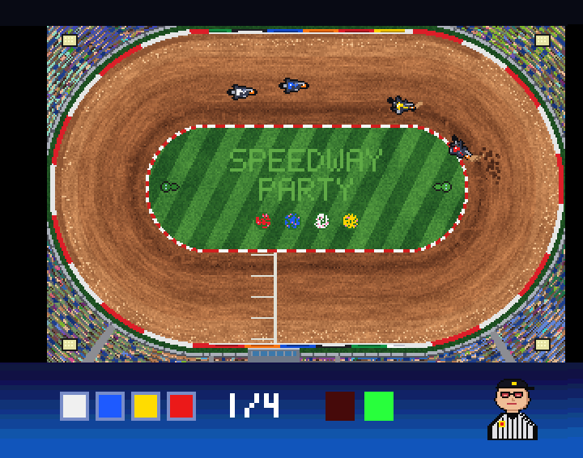
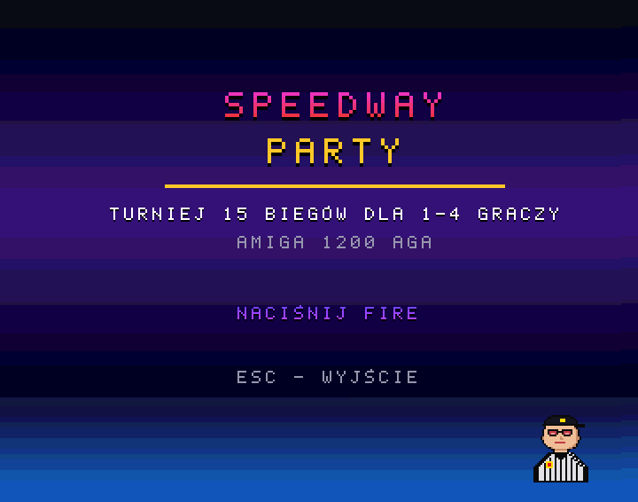
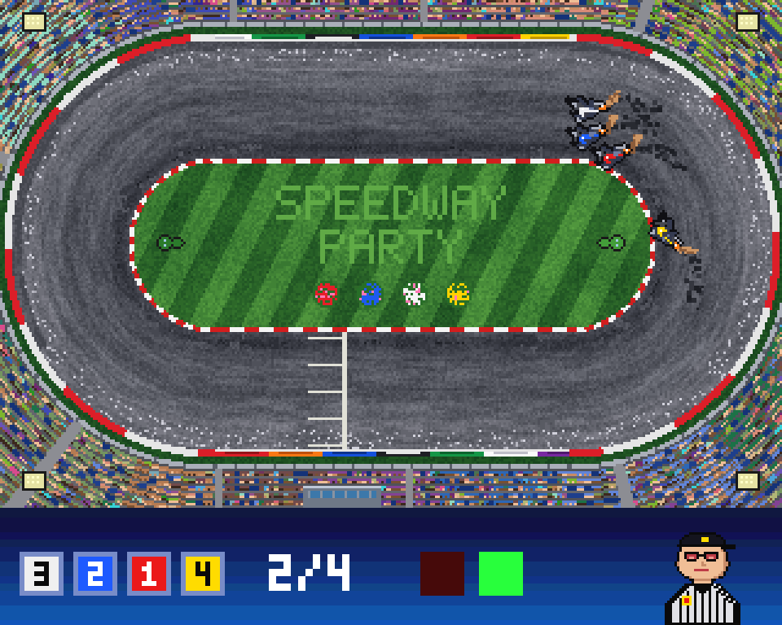
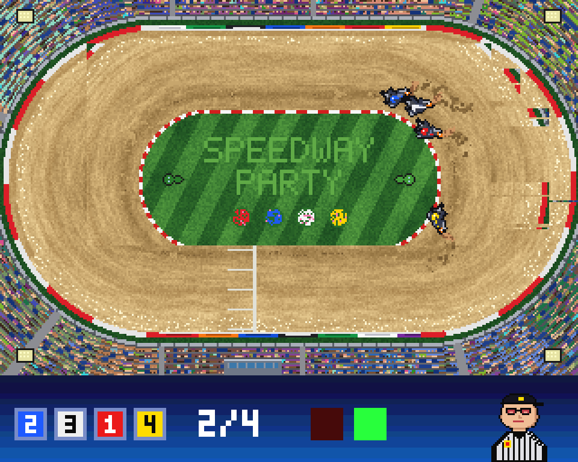

# Speedway Party

Zręcznościowa gra żużlowa na **Amigę 1200 (AGA, 68EC020, 2 MB Chip RAM)**. Turniej 15 biegów dla 1–4 graczy na jednej kanapie, wolne miejsca zajmują boty. Kod w C (Bebbo GCC, NDK 3.9).

|  |  |
|---|---|

*Gra uruchomiona w WinUAE (A1200, 68020, AGA, 2 MB Chip): bieg ze szprycą spod tylnego koła i plansza tytułowa z tęczą z Coppera.*

Więcej ekranów (zrzuty z kodu gry skompilowanego na PC):

| | | |
|---|---|---|
|  |  |  |
|  |  |  |
|  |  |  |


## Pobierz i zagraj

**[release/SpeedwayParty.zip](release/SpeedwayParty.zip)**: gotowa gra dla Amigi (plik wykonywalny, dane, `s/startup-sequence`, instrukcja `CZYTAJ.TXT`).

Wymagania: Amiga 1200 lub inna z chipsetem AGA, 68020, 2 MB Chip RAM, Kickstart 3.x. Fast RAM nie jest potrzebny.
- **Na Amidze:** rozpakuj, w Shellu wejdź do katalogu `SpeedwayParty` i uruchom `SpeedwayParty`.
- **W emulatorze:** rozpakuj i podepnij katalog `SpeedwayParty` jako dysk startowy (szczegóły niżej w sekcji *Uruchomienie w WinUAE*).

## Spis treści
1. [Mechanika gry](#mechanika-gry)
2. [Budowanie](#budowanie)
3. [Uruchomienie w WinUAE](#uruchomienie-w-winuae)
4. [Sterowanie](#sterowanie)
5. [Narzędzia na PC](#narzędzia-na-pc)
6. [Struktura projektu](#struktura-projektu)
7. [Znane ograniczenia / do zrobienia](#znane-ograniczenia--do-zrobienia)

---

## Mechanika gry

> Cztery motocykle, cztery okrążenia, jedna taśma. Bez hamulców, bez biegów, bez litości.

### 🏁 Turniej, czyli wieczór na stadionie
Gracie klasyczne zawody na 15 biegów, czterech zawodników w każdym. Za zwycięstwo są 3 punkty, potem 2, 1 i nic. Program jest ułożony tak, że każdy startuje z każdego pola, więc nikt nie może narzekać na losowanie.

Kolor kasku zdradza pole startowe: czerwony wewnątrz, potem niebieski, biały i żółty przy bandzie.

Na koniec przychodzą **biegi nominowane**. Lider tabeli wybiera pole pierwszy, a reszta bierze to, co zostało.

Remis punktowy o miejsce na podium rozstrzyga **bieg dodatkowy**: jadą tylko zawodnicy z remisu, a pola startowe są losowane. Nie ma liczenia zwycięstw ani kombinowania, decyduje tor.

Puste miejsca przy kanapie zajmują boty:
- **Amator** zaspał pod taśmą, łamie motocykl za mocno i trzyma się krawężnika jak tonący brzytwy.
- **Profi** ma refleks i nie zawaha się „zamknąć płotu”, gdy próbujesz go minąć po wewnętrznej.
- **Mistrz** czyta tor jak gazetę: wie, gdzie jest przyczepność, łamie dokładnie tyle, ile trzeba, a gdy trzeba, odjeżdża szeroko pod bandą.

### 🚦 Start spod taśmy
To tu wygrywa się połowę biegów. Trzymasz kierunek, ręka napięta, pali się czerwone. Czekasz sekundę, dwie, trzy, nigdy nie wiesz ile.

Zielone, brzęczyk, **puszczasz**. Kto puści szybciej, ten wystrzeli spod taśmy jak z procy.

Kto nie wytrzyma nerwowo i puści za wcześnie, usłyszy gwizdek: **TAŚMA!** Sędzia macha czerwoną flagą, a druga taśma w biegu oznacza wykluczenie. Kto z kolei przegapi zielone, będzie mielił kołem w miejscu, patrząc na plecy rywali.

### 🏍️ Jazda: dwa przyciski i cała prawda o żużlu
Gaz jest zawsze odkręcony do końca. Ty decydujesz tylko o jednym: **jak mocno złamać motocykl**.

**LEWO** kładzie maszynę w uślizg, tylne koło ucieka na zewnątrz, a rama ustawia się w łuk, najwyżej pod kątem 40°. **PRAWO** to kontra: prostuje motocykl i pozwala delikatnie odbić od krawężnika. Prawdziwy żużlowiec w prawo nie skręca, więc i tutaj ta strona jest wyraźnie słabsza.

Najważniejsza zasada: **każdy stopień uślizgu kosztuje prędkość**. Motocykl złamany do oporu skręci ostro, ale zwolni o jedną czwartą. Szybcy zawodnicy nie trzymają przycisku, tylko **pulsują**: łamią na wejściu, odpuszczają w środku łuku, prostują na wyjściu i znów mają pełny gaz na prostej.

Tor nie wybacza:
- **banda** zabiera ćwierć prędkości i prostuje motocykl;
- **krawężnik** lekko spowalnia i ustawia równolegle do toru;
- **kontakt łokieć w łokieć** spowalnia obu zawodników, więc taranowanie nic nie daje i wygrywa czysta jazda.

### 🟤 Nawierzchnia, która żyje
Tor nie jest jednolity. Przy krawężniku nawierzchnia jest ubita i przyczepna, środkiem biegnie wyjeżdżona koleina, a pod bandą zbiera się luźne **odsypisko**.

To tam rodzi się najpiękniejszy manewr: **„szeroka niesie”**. Jeśli wjedziesz pod bandę z pełną prędkością i w lekkim uślizgu, odsypisko wystrzeli cię do przodu. Jeśli wjedziesz za wolno, motocykl się w nim zakopie.

Tor **wyjeżdża się na Twoich oczach**. Każdy przejazd rozpędzonego motocykla ubija nawierzchnię, więc linia, którą jeździ cała stawka, z biegu na bieg ciemnieje, gładnieje, trzyma coraz lepiej i robi się najszybsza. Grudki szprycy spadające obok spulchniają tor, a równarka podczas przerwy zaciera ścieżki i wszystko zaczyna się od nowa. Po polewaniu wyjeżdżona linia przesycha pierwsza. Pytanie tylko, czy wolisz jechać sprawdzoną ścieżką za rywalem, prosto w jego szprycę, czy szukać własnej drogi.

W menu wybierasz jeden z trzech stadionów:

| Tor | Charakter |
|---|---|
| 🔴 **GRANIT** | Klasyczny owal z czerwonej nawierzchni. Dobry na początek. |
| ⚫ **BAKAŁAR** | Długie proste i ciasne łuki na ciemnym żużlu. Węższy i bardziej techniczny, ale trzyma koło lepiej niż inne. |
| 🟡 **PIASEK** | Krótkie proste i wielkie, okrągłe łuki. Ślisko, za to pod bandą czeka szerokie odsypisko dla odważnych. |

### 💧 Polewaczka, czyli tor zmienia się w trakcie zawodów
Na start turnieju wybierasz **stan toru**: suchy, wilgotny albo mokry.

Mokry tor ciemnieje, przy krawężniku zbierają się kałuże, a koło łapie wyraźnie gorzej. Motocykl skręca słabiej, wynosi go szerzej i trzeba łamać mocniej.

Po biegach 4, 7, 11 i 13 na tor wyjeżdżają **traktory**: jeden równa nawierzchnię, drugi ją polewa. Potem tor z biegu na bieg **przesycha**, a przyczepność powoli wraca. Linia, która wygrywała na początku zawodów, pod koniec może już nie działać.

### 🌪️ Szpryca
Każdy motocykl w uślizgu sypie spod tylnego koła **szprycę**, czyli wachlarz nawierzchni lecący do tyłu i na zewnątrz łuku.

Jedziesz tuż za rywalem? Dostajesz nią prosto w twarz i tracisz prędkość, metr po metrze. Siedzenie komuś na kole nic nie da: trzeba znaleźć **czystą linię**, wyjść z jego szprycy i zaatakować z boku. Tak samo jak na prawdziwym torze.

---

## Budowanie

### 1. Toolchain Bebbo (amiga-gcc)
Najprościej na Windows przez **WSL2 z Ubuntu**. Sam toolchain buduje się raz, ok. 30–60 min:

```bash
sudo apt update
sudo apt install make wget git gcc g++ lhasa libgmp-dev libmpfr-dev libmpc-dev flex bison gettext texinfo ncurses-dev autoconf rsync libreadline-dev
git clone https://github.com/bebbo/amiga-gcc
cd amiga-gcc
make update
make all -j4 PREFIX=$HOME/amiga-gcc
echo 'export PATH=$HOME/amiga-gcc/bin:$PATH' >> ~/.bashrc
```

Sprawdzenie: `m68k-amigaos-gcc --version`. NDK 3.9 i libnix są w toolchainie, nic więcej nie trzeba.

Aktualną listę zależności znajdziesz w README repozytorium [bebbo/amiga-gcc](https://github.com/bebbo/amiga-gcc).

### 2. Gra
W WSL, w katalogu projektu (np. `/mnt/e/Workshop/Speedway Party`):

```bash
make dist
```

Powstaje katalog `dist/`:
```
dist/SpeedwayParty          plik wykonywalny
dist/data/*                 grafika (3 tory), dźwięk - ładowane z PROGDIR:data/
dist/s/startup-sequence     uruchamia grę od razu po starcie Amigi
```

Gotowe dane (`data/`) są w repozytorium. Do budowania nie potrzebujesz Pythona.

---

## Uruchomienie w WinUAE

1. **Quickstart → Model: A1200**, konfiguracja z Kickstartem 3.0 lub 3.1. ROM musisz mieć własny, np. z Amiga Forever.
2. **CPU and FPU:** 68020, *cycle-exact* (najwierniejszy czas, ważny dla stałych 50 FPS). Bez FPU.
3. **RAM:** Chip 2 MB, Slow 0, Fast 0. Testujemy bez Fast RAM, tak jak na gołym A1200.
4. **Chipset:** AGA, PAL.
Gotowa konfiguracja jest w [tools/winuae/SpeedwayParty-A1200.uae](tools/winuae/SpeedwayParty-A1200.uae): wpisz w niej ścieżkę do swojego `dist/` i wczytaj ją w WinUAE (*Configurations → Load*) albo uruchom `winuae64.exe -f SpeedwayParty-A1200.uae`. Ręcznie:

5. **CD & Hard drives → Add Directory or Archive…**: wskaż katalog `dist/`.
   - *Device name*: `DH0`, *Volume label*: `Speedway`
   - *Boot priority*: 0 lub wyżej (katalog ma być dyskiem startowym)
6. **Game ports:** port 1 = joystick (klawiatura lub pad), port 0 = drugi joystick, jeśli gra 2+ graczy. **Nie zostawiaj myszy w porcie 0**, bo kursor w menu będzie skakał.
7. Start. Kickstart uruchomi `s/startup-sequence`, a ten od razu grę. Workbench nie jest potrzebny.
8. **Obraz na całe okno:** w szablonie konfiguracji okno ma 640×512 (obraz gry 320×256 powiększony 2×), a obraz jest wycentrowany (`gfx_xcenter/gfx_ycenter=smart`), więc gra wypełnia okno bez ramki. Ramkę wokół obrazu gra i tak wygasza (bit BRDRBLNK w AGA).

Jeśli wolisz Workbench: podepnij `dist/` jako dodatkowy dysk i w Shellu wpisz `cd Speedway:` i `SpeedwayParty`.

**ESC** wychodzi z gry i oddaje sterowanie systemowi.

### Gdy coś nie działa
| Objaw | Gdzie szukać |
|---|---|
| Obraz „poszatkowany”, przesunięty o 64 px | `DDF_STOP` i `MOD_ADJ` w `src/video.c` (pobieranie bitplanów w trybie 4×). W WinUAE działa `$38/$A0`. Do testów: `make dist EXTRA=-DDDF_STOP=0xD0` |
| Menu samo się przełącza | mysz w porcie 0: menu czyta tylko port 1 i klawiaturę, ale gracz 2 ustawiony na JOY 0 będzie „jechał” myszą |
| Zamiast grafiki są proste kształty | brak `data/` obok programu (gra wtedy rysuje grafikę zastępczą) |
| Brak dźwięku | brak `data/*.raw` |
| Gracze 3–4 na adapterze LPT nie reagują | bity adaptera w `src/input.c`, oznaczone „sprawdzić” |

---

## Sterowanie

Każdy gracz ma tylko **LEWO i PRAWO**. Gaz jest automatyczny.

| | Gracz 1 | Gracz 2 | Gracz 3 | Gracz 4 |
|---|---|---|---|---|
| domyślnie | joystick port 1 | joystick port 0 | klawisze **Z / X** | klawisze **N / M** |
| do wyboru w menu | + adapter 4 graczy (LPT), strzałki | | | |

- **Start spod taśmy:** trzymaj dowolny kierunek. Na zielonym świetle **puść**. Puszczenie przed zielonym to taśma (falstart). Trzymanie dłużej niż 0,3 s po zielonym to mielenie kołem w miejscu.
- **Jazda:** LEWO łamie motocykl w łuk (do 40°), PRAWO to kontra (do ok. 14°, głównie prostuje). Szczegóły w sekcji [Mechanika gry](#mechanika-gry).
- **Szeroka niesie:** pod bandą, z pełną prędkością i w lekkim uślizgu motocykl dostaje dodatkowe przyspieszenie. Za wolno pod bandą motocykl się zakopuje.
- **Szpryca:** jazda tuż za rywalem w uślizgu lekko spowalnia. Szukaj czystej linii.
- **Menu:** joystick (góra/dół/lewo/prawo/fire) albo strzałki i Return. Nazwisko edytujesz z klawiatury, polskie litery przez Alt (Alt+X = Ź, Alt+Z = Ż).
- Liczbę graczy zmieniasz w pierwszym wierszu ekranu ustawień (LEWO/PRAWO).

---

## Narzędzia na PC

Wymagają Pythona 3 z `numpy`, a sprawdzanie kodu i symulator także `pip install ziglang`.

| Polecenie | Co robi |
|---|---|
| `make assets` | regeneruje grafikę (`tools/genart.py`), dźwięk (`tools/genaudio.py`), font (`tools/genfont.py`) i podglądy w `art/` |
| `make release` | buduje paczkę do pobrania `release/SpeedwayParty.zip` (po `make dist`) |
| `make check` | sprawdza składnię i typy całego kodu Clangiem dla 68020 (atrapy NDK w `tools/ndkstub/`) |
| `make sim` | symulator: te same pliki logiki gry rozgrywają turniej botów bez grafiki |
| `sh tools/sim/batch.sh` | 5 turniejów, średnie punkty dla każdego poziomu AI (do strojenia) |
| `python tools/sim/plot.py` | tory jazdy z symulacji na tle toru, zapis do `art/sim_lines.png` |
| `sh tools/shots/run.sh` | zrzuty ekranu z prawdziwego kodu gry (UI, HUD, duszki, szpryca, traktory) skompilowanego na PC, zapis do `art/screen_*.png` |
| `python tools/import_engine.py plik.wav` | robi pętlę silnika dla Pauli z prawdziwego nagrania |

Tabela torów jest zapisana w dwóch miejscach: `track_defs` w `src/track.c` i `PRESETS` w `tools/genart.py`. Kolejność i geometria (`HALF_L, R_IN, R_OUT`) muszą być identyczne.

---

## Struktura projektu

```
src/
  main.c        pętla 50 Hz, maszyna stanów turnieju
  system.c      przejęcie i oddanie sprzętu, własne przerwanie VBL
  video.c       Copper-listy AGA: 8 bitplanów, paleta 24-bit, kolory per linia, HUD, podwójny bufor
  sprites.c     duszki 64 px (pary attached), klatki motocykli
  blit.c        Blitter: wypełnianie, kopiowanie, kropki „cookie-cut” (szpryca)
  start.c       procedura startowa, taśma, refleks
  race.c        model jazdy: auto-gaz, uślizg, banda, kontakt, okrążenia
  ai.c          boty: Amator / Profi / Mistrz
  roost.c       szpryca i woda z polewaczki (cząsteczki Blittera)
  track.c       geometria owalu, mapa przyczepności, wilgotność
  tractors.c    przerwa na tor (traktory na duszkach)
  tournament.c  tabela 15 biegów, punkty, biegi nominowane
  ui.c, text.c  ekrany tekstowe, font z polskimi literami
  hud.c         HUD: kolejność, okrążenie, światła, sędzia z flagą
  audio.c       Paula: silniki, kibice, brzęczyk, gwizdek
  input.c       joysticki, adapter LPT, klawiatura (CIA)
  assets.c      ładowanie data/ przed przejęciem sprzętu
data/           gotowe dane binarne (generowane narzędziami)
art/            podglądy PNG/WAV (nie trafiają na Amigę)
tools/          generatory, sprawdzanie kodu, symulator
```

---

## Znane ograniczenia / do zrobienia

### Stan
- Gra kompiluje się Bebbo GCC 6.5.0b bez ostrzeżeń i działa w WinUAE (A1200, 68020 cycle-exact, AGA, 2 MB Chip RAM, ROM AROS) przy stałych 50 FPS: plansza tytułowa, menu, turniej, biegi na wszystkich trzech torach, polewanie, dźwięk.
- **Nie była jeszcze testowana na prawdziwym A1200 ani z oryginalnym Kickstartem 3.1.** Zgłoszenia z prawdziwego sprzętu są bardzo mile widziane.
- Logikę (fizykę, boty, turniej) sprawdza symulator na PC (`make sim`). Prawdziwi gracze dopiero ocenią, jak sterowanie dwoma przyciskami czuje się w rękach, i parametry jazdy mogą się jeszcze zmienić.
- Gra zajmuje ok. 1 MB Chip RAM (trzy tory, motocykle, traktory, plansza tytułowa, dźwięk), więc potrzebuje A1200 z 2 MB Chip.

### Znane ograniczenia
- **Silniki słychać tylko dwa naraz** (lidera i drugiego zawodnika): Paula ma 4 kanały, a pozostałe dwa zajmują kibice i efekty.
- **Dźwięk silnika jest syntetyczny.** Prawdziwe nagranie można zamienić w pętlę dla Pauli narzędziem `tools/import_engine.py`, ale potrzebna jest licencja na nagranie.
- **Mysz w porcie 0:** menu jej nie czyta, ale gracz 2 ustawiony na „JOY 0” z myszą zamiast joysticka będzie „jechał” ruchami myszy.
- **Adapter 4 graczy na porcie równoległym** nie był testowany. Przypisanie bitów w `src/input.c` może wymagać poprawki.
- **Remis punktowy poza podium** (o 4. miejsce) rozstrzygają zwycięstwa biegów. O podium zawsze rozstrzyga bieg dodatkowy.
- **Boty** jeżdżą głównie wewnętrzną połową toru. Szeroka linia pod bandą to szansa dla ludzi.
- Tylko **PAL** (50 Hz).

### Pomysły na dalsze wersje
- [ ] obraz dyskietki **ADF** do Gotka i emulatorów
- [x] widoczne wyjeżdżone ścieżki (tor ciemnieje tam, gdzie jeździ stawka)
- [x] bieg dodatkowy przy remisie o miejsce na podium
- [ ] tabela rekordów (najlepsze czasy biegu i okrążenia na każdym torze) zapisywana na dysk
- [ ] tryb treningu: pojedynczy bieg albo jazda na czas
- [ ] muzyka w menu (moduł Protrackera)
- [ ] więcej torów i stadionów
- [ ] prawdziwe nagranie silnika żużlowego (z licencją)

---

## Licencja
[MIT](LICENSE) © 2026 b4rtiga
