# Speedway Party

**English** | [Polski](README_PL.md)

An arcade speedway racing game for the **Amiga 1200 (AGA, 68EC020, 2 MB Chip RAM)**. A 15-heat tournament for 1–4 players on one sofa, with bots filling the empty places. Written in C (Bebbo GCC, NDK 3.9).

**🌐 Game website: [b4rtiga.pl/speedway-party](https://b4rtiga.pl/speedway-party/?lang=en)** – play it right away in your browser (an Amiga 1200 emulator), screenshots, the trailer and downloads.

|  | 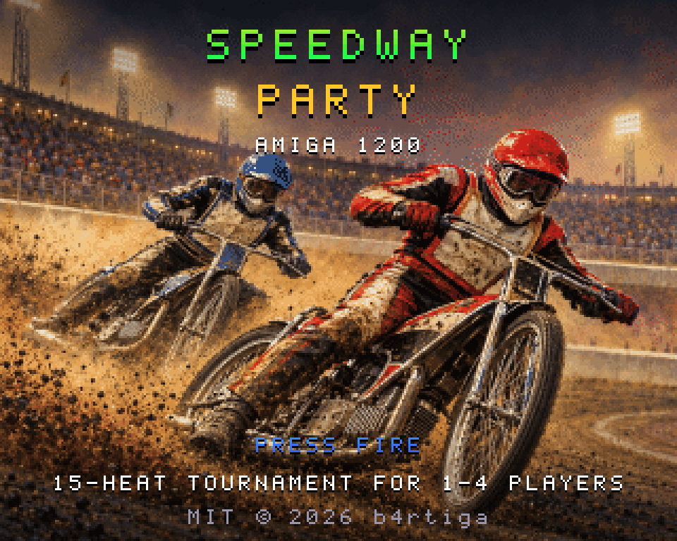 |
|---|---|

*Screens from the game (A1200, 68020, AGA, 2 MB Chip)*

### 🎬 Trailer
[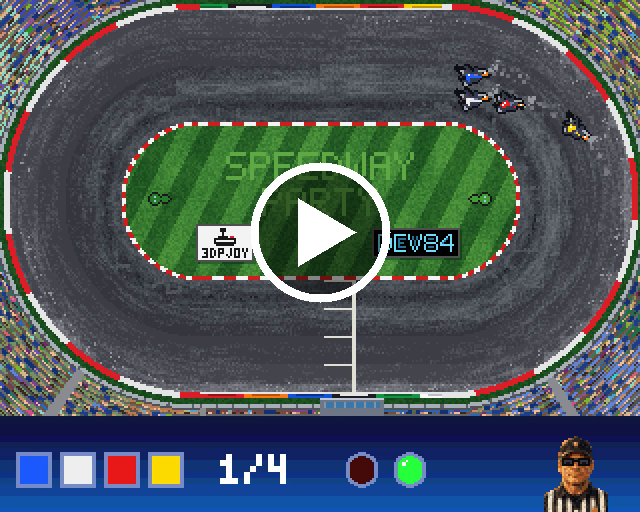](art/en/trailer.mp4)

More screens (captured from the game code compiled on a PC):

| | | |
|---|---|---|
|  |  |  |
|  | 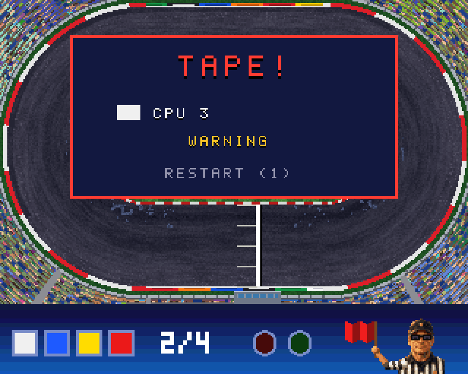 |  |
| 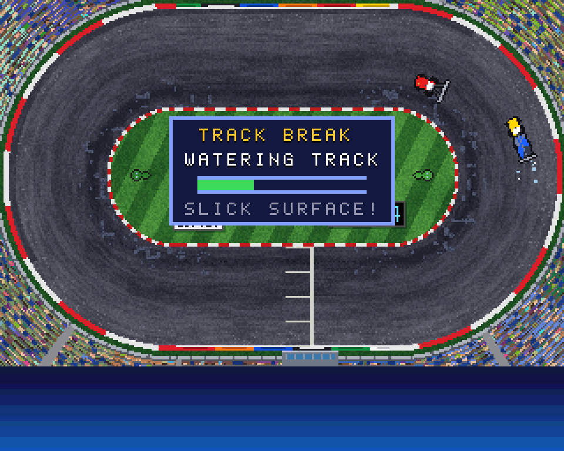 | 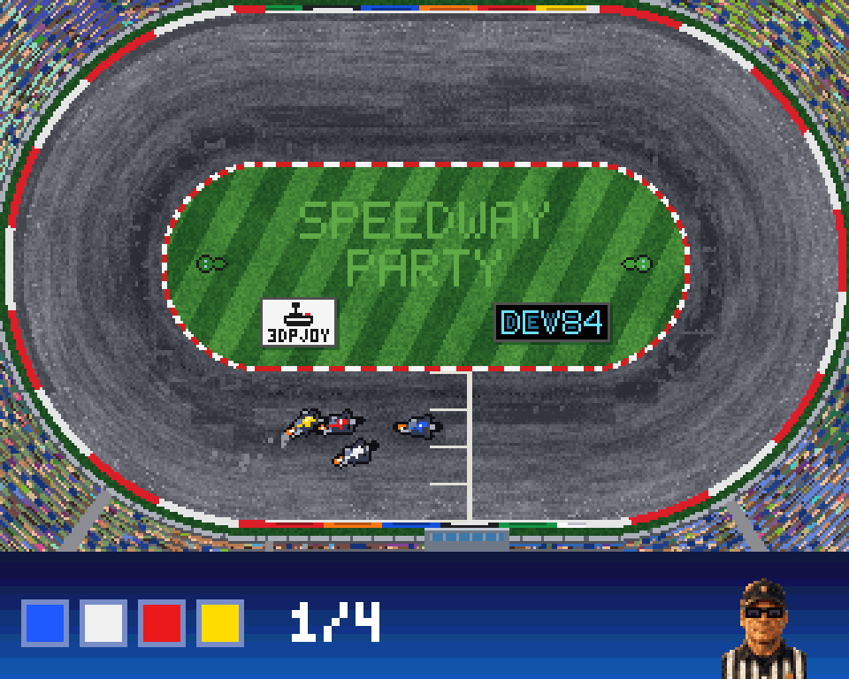 | 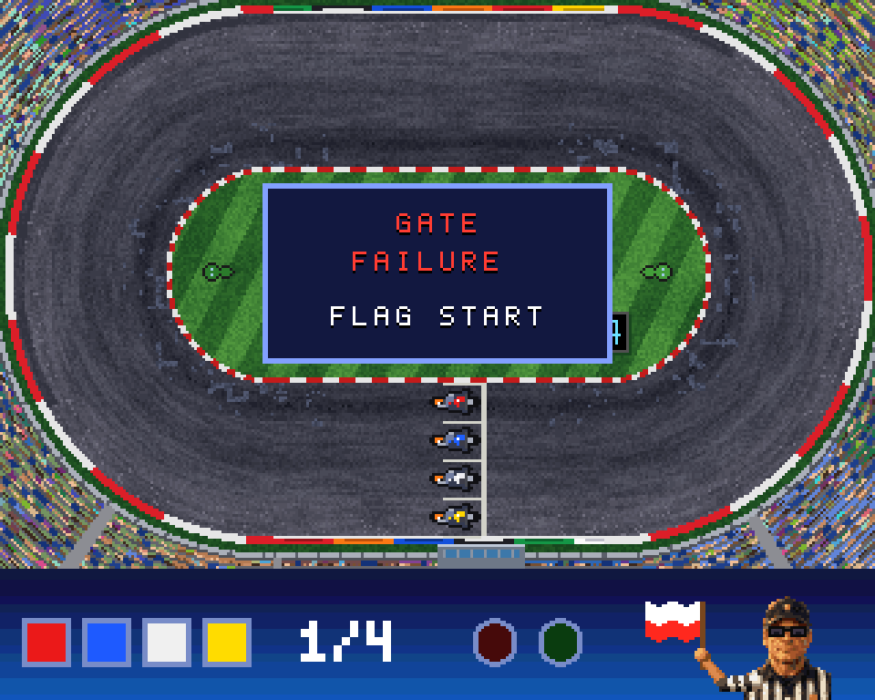 |
| 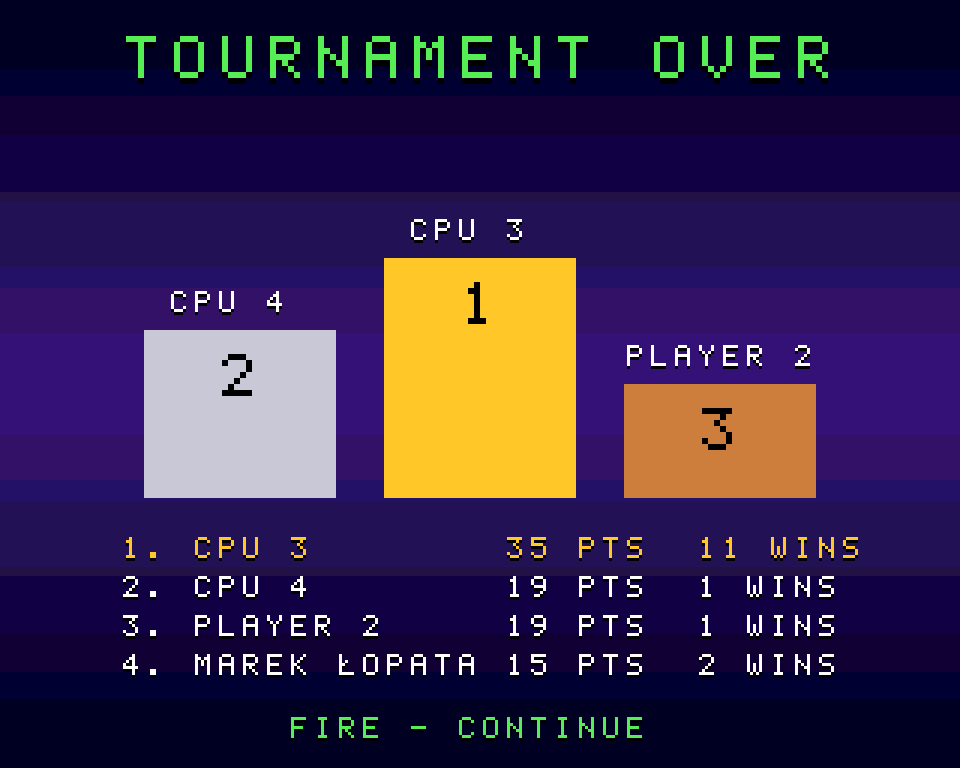 |  | 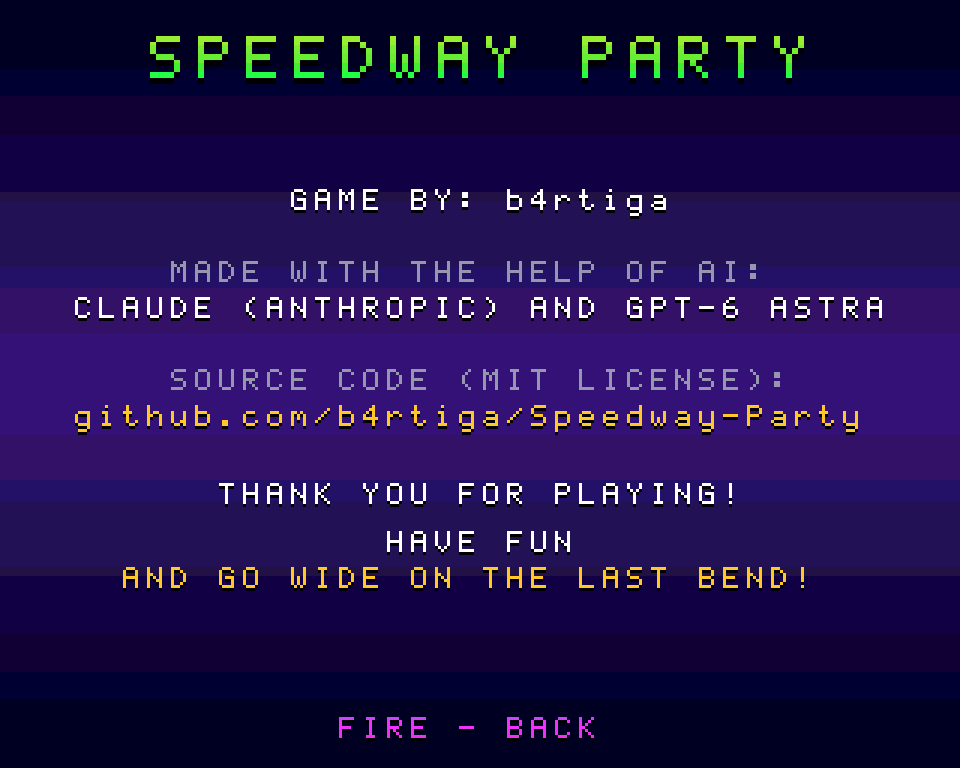 |
| 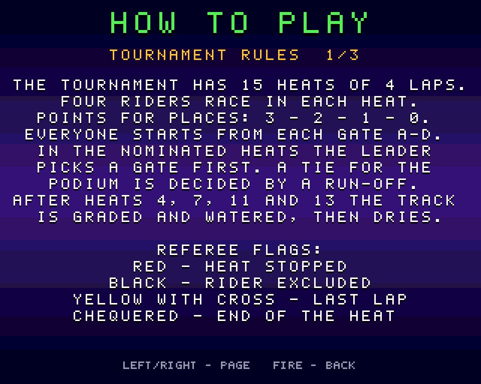 | 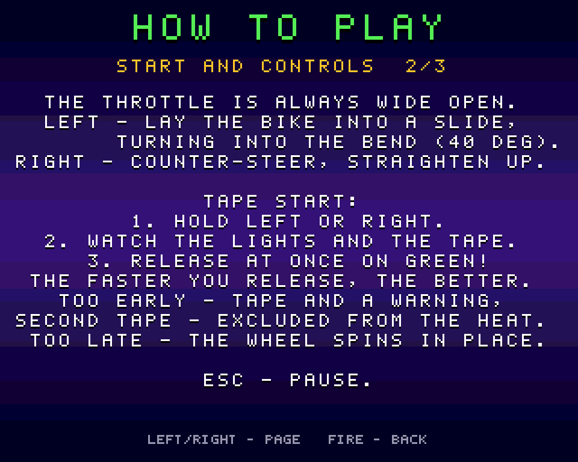 | 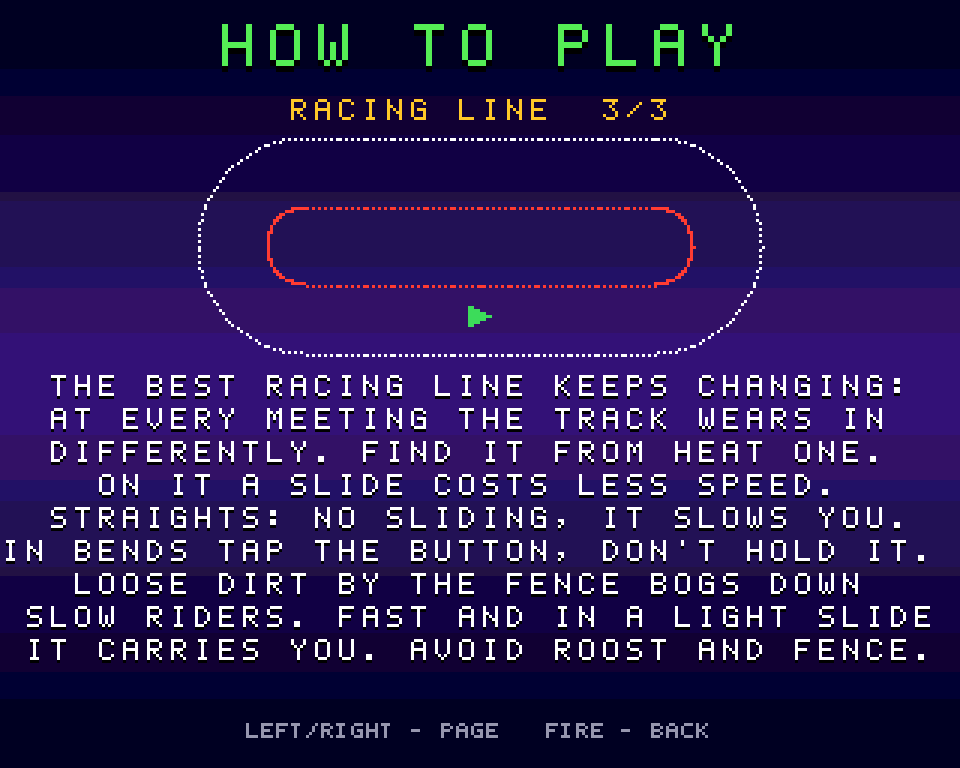 |
|  |  |  |
|  |  |  |
|  |  |  |
|  |  |  |


**What's new:** [CHANGELOG_EN.md](CHANGELOG_EN.md) (Polish: [CHANGELOG.md](CHANGELOG.md)).

**Manual:** [docs/DOCUMENTATION.md](docs/DOCUMENTATION.md) (source) and [docs/SpeedwayParty-documentation.pdf](docs/SpeedwayParty-documentation.pdf) (PDF, `python tools/mkdocs.py`). Polish: [docs/DOKUMENTACJA.md](docs/DOKUMENTACJA.md), [docs/SpeedwayParty-dokumentacja.pdf](docs/SpeedwayParty-dokumentacja.pdf).

## Download and play

The game comes in two languages: **English** and **Polish**.

**[release/SpeedwayParty_EN.adf](release/SpeedwayParty_EN.adf)** and **[release/SpeedwayParty_PL.adf](release/SpeedwayParty_PL.adf)**: boot floppies (880 KB, FastFileSystem) – in English and in Polish. Put the floppy in the drive (or a Gotek, or an emulator) and the game starts by itself. Inserted into a running Workbench, it has its own disk icon with the game icon and a short manual (`README.TXT` or `CZYTAJ.TXT`). The floppy needs Kickstart 2.0 or newer.

**[release/SpeedwayParty.zip](release/SpeedwayParty.zip)**: both versions for a hard disk or a CF card. Inside is the `SpeedwayParty/` drawer:

| File | What it is |
|---|---|
| `SpeedwayParty_EN` | **the compiled Amiga program** (an AmigaOS executable, no extension) – English version |
| `SpeedwayParty_PL` | the same program in Polish |
| `SpeedwayParty_EN.info`, `SpeedwayParty_PL.info` | two icons – double-click one on Workbench to start that version |
| `data/` | graphics, sound and music (shared by both versions); must sit next to the program |
| `s/startup-sequence` | starts the game (in Polish) right after the Amiga boots, when the directory is the boot disk |
| `README.TXT`, `CZYTAJ.TXT` (+ icons) | a short manual in English and in Polish |

The drawer icon `SpeedwayParty.info` sits next to the directory, so after unpacking onto the Amiga's disk the game drawer has an icon on Workbench. Both versions save records to the same `halloffame.dat` file.

Requirements: an Amiga 1200 or another AGA machine, 68020, 2 MB Chip RAM, Kickstart 3.x. Fast RAM is not needed.
- **On an Amiga:** unpack to a disk and double-click the `SpeedwayParty_EN` icon (or `SpeedwayParty_PL`) in the `SpeedwayParty` drawer – or in the Shell go to the `SpeedwayParty` directory and run `SpeedwayParty_EN`.
- **From a floppy:** put `SpeedwayParty_EN.adf` (or `SpeedwayParty_PL.adf`) in DF0: (in WinUAE: *Floppy drives → DF0:*) and start the Amiga.
- **In an emulator from a directory:** unpack and mount the `SpeedwayParty` directory as the boot disk (details below in *Running in WinUAE*).

### Which Amigas it runs on

The game should run on:

- an Amiga 1200 – also a "bare" one without Fast RAM (2 MB Chip RAM) – from a floppy or from a hard disk / CF card,
- an Amiga 1200 with an accelerator (68030/040/060) and Fast RAM,
- an Amiga 4000 and other computers with the AGA chipset and Kickstart 3.0, 3.1 or 3.2,
- Amiga emulators set up as an A1200: WinUAE, FS-UAE, EmulatorJS (PUAE),
- THEA500 Mini – the ADF floppy from a USB stick, with the A1200 model in the game settings.

## Contents
1. [Game mechanics](#game-mechanics)
2. [Building](#building)
3. [Running in WinUAE](#running-in-winuae)
4. [Controls](#controls)
5. [PC tools](#pc-tools)
6. [Project structure](#project-structure)
7. [Technology stack](#technology-stack)
8. [Known limitations / to do](#known-limitations--to-do)
9. [How the game was made](#how-the-game-was-made)

---

## Game mechanics

> Four bikes, four laps, one tape. No brakes, no gears, no mercy.

### 🏁 The tournament, or an evening at the stadium
You ride a classic 15-heat meeting, four riders in every heat. A win is worth 3 points, then 2, 1 and nothing. The programme is arranged so that everyone starts from every gate, so nobody can blame the draw.

Every rider keeps the same helmet colour for the whole tournament: red, blue, white or yellow. The starting gate changes every heat and the start girls show it. Before each heat, after the race programme, they stand at gates A–D holding boards in the helmet colours of the riders starting there, and sway their hips (3 seconds or FIRE).

At the end come the **nominated heats**. The leader of the table picks a gate first, and the rest take what is left.

A tie on points for a podium place is settled by a **run-off**: only the tied riders take part and the gates are drawn. No counting wins, no tricks – the track decides.

After the podium comes the **"OVAL HERALD"** newspaper (special edition): a headline that fits how the meeting went (a title after a run-off, a win with a track record, a clean sweep, a one-point margin or simply "the oval has a winner"), a short comment, the final table and two facts, e.g. the number of false starts. The newspaper only writes what follows from the results. FIRE starts a new tournament.

When started from a floppy, the game first shows the title screen with "LOADING…" and loads the rest of the data in the background. The title screen waits for FIRE, then you choose **EVENT**, **PRACTICE**, **HOW TO PLAY** (3 pages: rules, start and controls, the racing line with a track diagram; LEFT/RIGHT turns the page), **RECORDS** (the track tables) or **CREDITS**. FIRE or ESC returns from the manual, the records and the credits. Before the event you choose the number of players (0–4) and the bot skill, and in SETTINGS the event type, track condition, time of day, rain, defects and music; the cursor starts on START. PLAYER 1 gets the control you confirmed EVENT with: joystick in port 0 – JOY 0, in port 1 – JOY 1, keyboard (Return) – CURSORS (the player who had that control takes player 1's previous one). Riders start as PLAYER 1, PLAYER 2… and CPU 2, CPU 3…, and you can change every name. After each heat the table shows the points from every heat and the track records.

**Track records:** the 5 best heats and the 5 best laps by players (bots never enter the tables). A player who gets into the top five in a tournament enters a name once, after the meeting (after the newspaper) – it goes to all their places; the game doesn't interrupt between heats. The name has up to 7 characters (by default the first word of the rider's name): UP/DOWN changes the character, LEFT/RIGHT the position, and you can also type on the keyboard; FIRE or Return saves. The tables are saved to `halloffame.dat` next to the game (the previous version is kept as `halloffame.bak`) when you quit: ESC on the menu screen and ESC once more. Resetting or switching off the Amiga during play loses the session's results, and on a write-protected floppy saving silently fails. Player records from the old `records.dat` file are imported once, on the first start.

Bots take the empty places on the sofa:
- **Rookie** oversleeps at the tape, lays the bike down too hard and clings to the kerb like a drowning man to a straw.
- **Pro** has quick reflexes and won't hesitate to "shut the door" when you try to pass on the inside.
- **Master** reads the track like a newspaper: knows where the grip is, slides exactly as much as needed and, when it pays, goes wide by the fence.

### 🚦 The tape start
This is where half the heats are won. You hold a direction, arm tense, the red light is on. You wait one second, two, three – you never know how long.

Green, buzzer, the snap of the released tape – **let go**. Whoever lets go first shoots off the tape like a slingshot.

Whoever loses their nerve and lets go too early hears the crowd groan: **TAPE!** The referee waves the red flag, and a second tape offence in a heat means exclusion. Whoever misses the green spins the wheel on the spot, watching the others' backs.

Round start lights glow in the bar at the bottom of the screen. In the middle of the screen, in a small window on the infield (it doesn't cover the riders on the straight), you see the starting gate: the lamp and the tape. On green the tape bends a little and flies quickly up out of the window (about 0.2 s), then the window disappears.

Every now and then the starting gate fails: the lights go out, the tape disappears and the referee starts the heat with the **national flag**. Then you have to watch his hand.

### 🚩 The referee's flags
The referee in the corner of the screen, in a black-and-white striped shirt, shows flags as at a real meeting: he waves them with a raised arm. When nothing is happening, he blinks and glances around behind his tinted glasses.

| Flag | Meaning |
|---|---|
| 🏁 chequered | end of the heat: from the moment the leader enters the home straight of the last lap, through the winner's finish, to the last rider. The results appear 2 seconds after the last rider crosses the line |
| 🟥 red | the heat is stopped, e.g. after touching the tape |
| ⬛ black | a rider is excluded (e.g. a second tape offence in a heat) |
| 🟨✖️ yellow with a black cross ("the scythe") | last lap: from the leader entering the home straight at the end of lap 3 until 2 s after the last rider crosses the line |
| 🇵🇱 national | emergency start after a starting gate failure |

### 🏍️ Riding: two buttons and the whole truth about speedway
The throttle is always wide open. You decide only one thing: **how hard to lay the bike down**.

**LEFT** puts the machine into a slide, the rear wheel swings out and the frame turns into the bend, up to 40°. **RIGHT** is counter-steering: it straightens the bike and lets you push gently off the kerb. A real speedway rider doesn't turn right, so here too that side is clearly weaker.

The most important rule: **every degree of slide costs speed**. A bike laid down all the way turns sharply but loses a quarter of its speed. Fast riders don't hold the button, they **pulse** it: lay down on entry, ease off in the middle of the bend, straighten on the exit and have full throttle again on the straight.

The track doesn't forgive:
- **the fence** takes a quarter of your speed and straightens the bike;
- **the kerb** slows you down slightly and sets you parallel to the track;
- **elbow-to-elbow contact** slows both riders, so ramming gets you nothing and clean riding wins.

### 🟤 A surface that lives
The track is not uniform. By the kerb the surface is packed and grippy, a worn-in groove runs down the middle, and loose **dirt** gathers by the fence.

That's where the most beautiful move is born: **"going wide"**. Enter the dirt by the fence at full speed in a light slide and it shoots you forward. Enter the loose dirt too slowly and the bike bogs down. A worn-in, packed line by the fence doesn't bog you down any more.

The track **wears in from heat to heat**. Every pass of a fast bike packs the surface (grip changes at once, and the game draws the darker strip between heats), so the line the whole field rides gets darker, smoother and grippier heat after heat and becomes the fastest. Lumps of roost landing next to it loosen the track, and the grader wipes the grooves during the break so everything starts again. After watering, the worn-in line dries first. The only question is whether you'd rather ride a proven line behind a rival, right into their roost, or look for your own way.

Every tournament is **a different track**: at the start of the meeting 1–2 worn-in lines are drawn at different places across the track (by the kerb, in the middle or wide). The packed line grips better and shows as a darker strip, so it pays to find it quickly: it's the ideal line of that tournament. In its middle a slide costs up to 40% less speed, and the further from it, the higher the penalty for laying the bike down.

The meetings are held on a classic oval with a dark grey **shale** surface, with the start line in the middle of the straight. Sponsor banners stand on the infield: 3DPJOY and DEV84.

### 💧 The water cart, or a track that changes during the meeting
At the start of a tournament **the track condition is drawn**: dry, damp or wet. If you prefer another one, change it in the menu.

A wet track darkens, puddles gather by the kerb, and the wheel grips clearly worse. The bike turns less, drifts wider, and you have to lay it down harder.

After heats 4, 7, 11 and 13 **tractors** come out: one grades the surface, the other waters it. Then the track **dries** from heat to heat and the grip slowly comes back. The line that won at the beginning of the meeting may no longer work at the end.

### 🌪️ Roost
Every bike in a slide throws **roost** from its rear wheel – a fan of shale flying backwards and out of the bend.

Riding right behind a rival? You get it straight in the face and lose speed, metre by metre. Sitting on someone's wheel gets you nothing: you have to find a **clean line**, get out of their roost and attack from the side. Just like on a real track.

### 🌙 Night, rain, team match and championship
In the event **SETTINGS** you choose what the evening at the stadium looks like:

- **Event:** an individual tournament, a **team match** (the home team in red and blue helmets against the away team in white and yellow; each team's pair starts from gates A+C or B+D in turn, heats end 5:1, 4:2 or 3:3) or a **championship** – three rounds with the same riders, points add up as in the Grand Prix, and after the last round the champion and fireworks.
- **Time:** at **night** the track is lit by four floodlight masts, the lamps shine with a soft glow and the bends are in full, warm light.
- **Rain:** in a random heat (2nd–5th) it starts raining. The track stops drying and gets softer and less grippy heat by heat.
- **Defects:** now and then an engine coughs, smokes and dies, and the rider rolls onto the infield – 0 points ("DEF").
- **Track condition** at the start and **music** in the menus.

A **crash** can happen in a heat: a hard hit on the fence, riding right along the fence for long or running into a rival. The referee shows the red flag, the faller is excluded and the heat is rerun from the tape. When the runner-up crosses the line at most 0.1 s behind the winner, the game shows a **photo finish**: the end of the heat in slow motion and a freeze-frame on the line.

**PRACTICE** in the menu: alone on the track, unlimited laps, with the current lap time, the last lap and the track record on the infield. You choose the conditions (track condition, time of day and rain) on a separate screen before the start.

The game remembers the names, controls, bot skills and all the settings (the `settings.dat` file next to the game).

---

## Building

### 1. The Bebbo toolchain (amiga-gcc)
The easiest way on Windows is **WSL2 with Ubuntu**. The toolchain itself is built once, about 30–60 min:

```bash
sudo apt update
sudo apt install make wget git gcc g++ lhasa libgmp-dev libmpfr-dev libmpc-dev flex bison gettext texinfo ncurses-dev autoconf rsync libreadline-dev
git clone https://github.com/bebbo/amiga-gcc
cd amiga-gcc
make update
make all -j4 PREFIX=$HOME/amiga-gcc
echo 'export PATH=$HOME/amiga-gcc/bin:$PATH' >> ~/.bashrc
```

Check: `m68k-amigaos-gcc --version`. NDK 3.9 and libnix come with the toolchain, nothing else is needed.

The current list of dependencies is in the README of the [bebbo/amiga-gcc](https://github.com/bebbo/amiga-gcc) repository.

### 2. The game
In WSL, in the project directory (e.g. `/mnt/e/Workshop/Speedway Party`):

```bash
make dist
```

This creates the `dist/` directory:
```
dist/SpeedwayParty          the executable
dist/data/*                 graphics, sound, music - loaded from PROGDIR:data/
dist/s/startup-sequence     starts the game right after the Amiga boots
```

The ready data (`data/`) is in the repository. You don't need Python to build.

**The menu music** is chosen before compiling in [build.cfg](build.cfg):

```
MUSIC = BlackMotor
MUSIC_ADPCM = NIE
```

| Value | Track |
|---|---|
| `BlackMotor` | "Black Motor", 13.3 s, 208 KiB in PCM, 104 KiB in ADPCM – the default track |
| `NightGrid` | "Night Grid", 27.4 s, 428 KiB in PCM, 214 KiB in ADPCM |
| `BRAK` | no music, saves Chip RAM |

The tracks are in `src/music/<name>/` as ready `*_s8.raw` mixes (8-bit mono PCM, ~16 kHz PAL). `make dist` saves the chosen one as `data/music.raw`. By default (`MUSIC_ADPCM = NIE`) the music is the original PCM. With `MUSIC_ADPCM = TAK` `make` encodes the track to 4-bit IMA ADPCM (`tools/adpcm.py`) – half the memory, slightly more noise; the game decodes it while playing, a chunk per frame, which made the music stutter in emulators on weaker hardware (e.g. THEA500 Mini). To listen on a PC: `python tools/adpcm.py --wav data/music.raw music.wav`. For a one-off you can also give the track on the command line: `make dist MUSIC=NightGrid`. A new track is a new directory in `src/music/` with a `*_s8.raw` file.

---

## Running in WinUAE

1. **Quickstart → Model: A1200**, a configuration with Kickstart 3.0 or 3.1. You need your own ROM, e.g. from Amiga Forever.
2. **CPU and FPU:** 68020, *cycle-exact* (the most faithful timing, important for a steady 50 FPS). No FPU.
3. **RAM:** Chip 2 MB, Slow 0, Fast 0. We test without Fast RAM, just like on a bare A1200.
4. **Chipset:** AGA, PAL.
A ready configuration is in [tools/winuae/SpeedwayParty-A1200.uae](tools/winuae/SpeedwayParty-A1200.uae): put the path to your `dist/` in it and load it in WinUAE (*Configurations → Load*) or run `winuae64.exe -f SpeedwayParty-A1200.uae`. By hand:

5. **CD & Hard drives → Add Directory or Archive…**: choose the `dist/` directory.
   - *Device name*: `DH0`, *Volume label*: `Speedway`
   - *Boot priority*: 0 or higher (the directory must be the boot disk)
6. **Game ports:** port 1 = joystick (keyboard or pad), port 0 = second joystick (e.g. a USB joystick) in **Joystick** mode, not mouse, for 2+ players. **Don't leave a mouse in port 0**, or the menu cursor will jump.
7. Start. Kickstart runs `s/startup-sequence`, which starts the game straight away. Workbench is not needed.
8. **Picture filling the window:** in the configuration template the window is 640×512 (the 320×256 game picture doubled) and the picture is centred (`gfx_center_horizontal/gfx_center_vertical=smart`; the older names `gfx_xcenter/gfx_ycenter` are ignored by new WinUAE, and the picture was shifted 9 pixels right with the right edge cut off), so the game fills the window without a border. The game blanks the border around the picture anyway (the AGA BRDRBLNK bit).

If you prefer Workbench: mount `dist/` as an extra disk and in the Shell type `cd Speedway:` and `SpeedwayParty`.

**ESC** (or the second joystick button) pauses with a question. During a tournament the game asks whether to return to the main menu, in the settings it goes straight back to the menu screen, and on the menu and title screens it asks whether to quit the game. A second ESC means "yes", FIRE returns to the game.

With **0 players** the whole tournament is ridden by bots: a demo mode.

### When something doesn't work
| Symptom | Where to look |
|---|---|
| The picture is "shredded", shifted by 64 px | `DDF_STOP` and `MOD_ADJ` in `src/video.c` (4× bitplane fetch). `$38/$A0` works in WinUAE. For testing: `make dist EXTRA=-DDDF_STOP=0xD0` |
| The joystick in port 0 (JOY 0) only registers left, not right, and "moves" when released to the centre | the emulator gives the joystick in port 0 as a mouse: set port 0 to **Joystick** mode (WinUAE: *Game ports*, in the configuration `joyport0=joy0`, `joyport0mode=djoy`, as in the template; similarly in other emulators) |
| The menu switches by itself | a mouse in port 0: the menu reads only port 1 and the keyboard, but player 2 set to JOY 0 will "ride" with the mouse |
| Simple shapes instead of graphics | no `data/` next to the program (the game then draws placeholder graphics) |
| No sound | no `data/*.raw` |
| No menu music | `MUSIC = BRAK` in `build.cfg`, no `data/music.raw`, or the MUSIC: NO option in the settings |
| Players 3–4 on the parallel port adapter don't respond | the adapter bits in `src/input.c`, marked "to check" |
| Cursor keys don't work, the heat waits for the start | in the WinUAE template (`joyport1=kbd2`) the cursor keys and right Ctrl emulate the **joystick in port 1**. The **JOY 1** and **CURSORS** settings read both sources (joystick in port 1 and the keyboard cursor keys), unless another player has chosen the other one. When the heat waits for a player who isn't holding a direction, the game shows a hint |

---

## Controls

Every player has only **LEFT and RIGHT**. The throttle is automatic.

| | Player 1 | Player 2 | Player 3 | Player 4 |
|---|---|---|---|---|
| default | joystick port 1 | joystick port 0 | keys **Z / X** | keys **N / M** |
| optional in the menu | + 4-player adapter (parallel port), cursor keys (JOY 1 and the cursor keys work interchangeably when nobody else uses them) | | | |

- **Tape start:** hold any direction. On the green light **let go**. Letting go before green is a tape offence (false start). Holding longer than 0.3 s after green spins the wheel on the spot.
- **Riding:** LEFT lays the bike into the bend (up to 40°), RIGHT is counter-steering (up to about 14°, mostly straightens). Details in [Game mechanics](#game-mechanics).
- **Going wide:** by the fence, at full speed and in a light slide the bike gets an extra push. Too slow by the fence and the bike bogs down.
- **Roost:** riding right behind a sliding rival slows you down a little. Look for a clean line.
- **Menus:** joystick in port 1 or 0 (up/down/left/right, FIRE = confirm) or the cursor keys and Return. The **second joystick button** works like ESC (pause with a question, back from the manual and the credits).
- **CD32 pad** (also THEA500 Mini's pad): red = FIRE, blue = ESC. The whole game works without a keyboard.
- **The joystick in port 0** must be set to joystick mode in the emulator, not mouse (WinUAE: *Game ports*). Riders are named PLAYER 1, PLAYER 2… (human) and CPU 2, CPU 3… (bots) at first, depending on the number of players. You edit a name on the keyboard; Polish letters via Alt (Alt+X = Ź, Alt+Z = Ż).
- You change the number of players in the first row of the event screen (LEFT/RIGHT).

---

## PC tools

They need Python 3 with `numpy`, and the code check and simulator also need `pip install ziglang`.

| Command | What it does |
|---|---|
| `make assets` | regenerates the graphics (`tools/genart.py`, `tools/gentitle.py`, `tools/gengirls.py`), sound (`tools/genaudio.py`) and font (`tools/genfont.py`); working previews (mock-ups, frame sheets, WAV) go to `build/preview/` outside the repo |
| `make dist-en` | the `dist-en/` directory with the English version (the program built with `-DLANG_EN`, objects in `build/en/`; the texts of both versions sit side by side in the code as `T("po polsku", "in English")`) |
| `make release` | builds the `release/SpeedwayParty.zip` package (both languages) and the boot floppies `release/SpeedwayParty_PL.adf` and `release/SpeedwayParty_EN.adf` (`tools/mkadf.py`, no external tools) |
| `python tools/mkicons.py preview` | Workbench icons (`tools/mkicons.py`: game, drawer, disk, manual; classic OS 2.x/3.x format, 4 colours) – preview in `build/preview/icon_*.png`; `make dist` / `make release` add the icons to the packages |
| `make whdload` | a WHDLoad version (in preparation, not part of the release): the game built with `-DWHDLOAD` without the OS (`src/whd.c`, `src/whdstart.s`) and the slave `tools/whdload/slave.s` in `dist-whd/`; waiting for a test with the original Kickstart 3.1 |
| `make cd32 CD32TM=…/CD32.TM` | CD32 disc images (`tools/mkiso.py`: ISO 9660 without external tools); a CD32 boots only from a disc with the Commodore `CD32.TM` file, which is not in the repository; not tested on a CD32 yet |
| `sh tools/sim/pack_test.sh` | unpacking test: files packed by `tools/pack.py` and loaded by the game's `asset_load` = the data in `data/`, damaged ones rejected |
| `python tools/gentitle.py` | the title screen from the illustration `src/title.png`: 320×256 crop, its own AGA palette and dithering (`data/title.bpl`, `data/title.pal`) |
| `python tools/genreferee.py` | the referee's portrait in the HUD from `src/referee.png`: 32×38, its own shades in free HUD palette colours, plus the painted arm with a fist in two flag-waving phases (`data/refarm.bin`; used by `tools/genart.py`; needs ffmpeg) |
| `python tools/gengirls.py` | the start girls from `src/girls.png`: four 48×96 figures, a shared 31-colour palette taken from the picture, gate colours from the UI, light dithering (`data/girls.bin`; needs ffmpeg) |
| `make check` | checks the syntax and types of all the code with Clang for 68020 (NDK stubs in `tools/ndkstub/`) |
| `make sim` | simulator: the same game logic files ride a bots' tournament without graphics |
| `make asan` | memory check in WSL (AddressSanitizer): PL and EN screenshots, the trailer and the simulator – catches too-short buffers and bad pointers that silently corrupt the stack on the Amiga |
| `sh tools/sim/news_test.sh` | newspaper test: headline choice in scenarios, the tournament summary, resetting the facts, long names |
| `sh tools/sim/records_test.sh` | record table test: TOP 5, ties, names, the `halloffame.dat` file (also damaged and older versions) |
| `sh tools/sim/settings_test.sh` | test of saving and loading the settings (`settings.dat`) on an "in-memory disk" |
| `sh tools/sim/music_test.sh` | menu music test: streaming through the DMA buffers (emulated Paula) and the ADPCM decoder – every played sample matches |
| `sh tools/sim/sprites_test.sh` | bike frame test: one set + the helmet colour applied when copying = 4 sets made by `tools/genart.py --bikes4`, bit for bit |
| `sh tools/sim/start_test.sh [tournaments]` | start fairness: 4 identical bots, results by starting gate A–D |
| `sh tools/sim/batch.sh` | 5 tournaments, average points for each AI level (for tuning) |
| `python tools/sim/plot.py` | riding lines from the simulation over the track, saved to `art/sim_lines.png` |
| `sh tools/shots/run.sh` | screenshots from the real game code (UI, HUD, sprites, roost, tractors) compiled on a PC, saved to `art/screen_*.png` (`LANG_EN=1` – English, `art/en/`) |
| `python tools/import_engine.py file.wav` | makes the Paula engine loop from a recording (currently `src/speedway_500cc_10000rpm_loop.wav`; `make assets` does it by itself) |
| `python tools/mkdocs.py` | documentation: `docs/DOKUMENTACJA.md` and `docs/DOCUMENTATION.md` → PDF (print HTML; Edge or Chrome prints the PDF in the background; version from git) |
| `python tools/mksocial.py` | the link preview image for GitHub, `art/social_preview.jpg` (1280×640, under the 1 MB limit; needs ffmpeg) |
| `python tools/mkcinema.py` | the cinematic trailer `art/trailer.mp4` (16:9, 35 s; `--en` – English, `--reuse` – without re-rendering the game): tape start, roost, night, rain, engine failure, crash, photo finish and championship from the real game code (`cinema` mode in `tools/shots`), a virtual camera following the bikes, captions in the game font, engines from the `audio.c` logic |
| `sh tools/mktrailer.sh` | the "gameplay" trailer `art/trailer_gameplay.mp4` from the real game code: menu, start and one lap of a heat with engine sound (`audio.c` logic, mixer `tools/trailer_audio.py`) and a transition to the title illustration (needs ffmpeg) |
| `make dist EXTRA=-DAUTOPLAY` | a test build without a keyboard: goes through the menus by itself and rides a bots' tournament (for checking in an emulator) |
| `make dist EXTRA=-DSHOW_LAG` | a measurement build: dropped frames in a heat and the peak time (in raster lines out of 313) of parts of the heat logic in the HUD: bikes and bots, roost, track, all the logic |
| `make dist EXTRA="-DSHOW_LAG -DAUTOPLAY -DPROF_LOG"` | measurement to a file: the bots ride 3 heats and on exit the game writes `dist/prof.txt` (average and peak times of the parts of the frame for the menus, the start with the first bend and the rest of the heat) |
| `make dist EXTRA="-DSHOW_LAG -DSHOW_START"` | tape start measurement: dropped frames in the tape-release window and peak times of logic, drawing and sprites+HUD in that window |

The track geometry is stored in two places: `track_defs` in `src/track.c` and `PRESETS` in `tools/genart.py`. The values (`HALF_L, R_IN, R_OUT`) must be identical.

---

## Project structure

```
src/
  main.c        50 Hz loop, tournament state machine
  system.c      taking over and giving back the hardware, own VBL interrupt, waiting for the frame with STOP
  video.c       AGA Copper lists: 8 bitplanes, 24-bit palette, per-line colours, HUD, double buffering
  sprites.c     32 px sprites (attached pairs), bike frames (one set), copy per bike and buffer with the helmet colour, position in 1/4 px
  blit.c        Blitter: filling, copying
  start.c       start procedure, tape, reflexes
  race.c        riding model: auto throttle, slide, fence, contact, laps, falls, photo finish
  ai.c          bots: Rookie / Pro / Master
  roost.c       roost, water from the water cart and rain (dots drawn by the CPU)
  track.c       oval geometry, grip map, moisture, worn-in grooves (repaint queue), night
  tractors.c    track break (tractors as sprites)
  tournament.c  15-heat table, points, nominated heats, team match, championship
  ui.c, text.c  text screens, font with Polish letters
  hud.c         HUD: helmet colours in order, lap, round lights, referee with flags
  audio.c       Paula: engines, crowd, buzzer, crowd groan, cheer on the last straight, menu music
  input.c       joysticks, parallel port adapter, keyboard (CIA)
  assets.c      loading data/ before taking over the hardware, unpacking files packed on the floppy (tools/pack.py)
  records.c     track records on disk (halloffame.dat + .bak, import of the old records.dat), settings.dat
  hof.c         TOP 5 tables of heats and laps, player names, file format (test: tools/sim/records_test.sh)
  newspaper.c   the newspaper after the meeting: tournament snapshot, headline and fact choice
  music/        menu tracks (ready *_s8.raw mixes), chosen in build.cfg
  banners/      banner logos (SVG source)
build.cfg       build settings (music choice)
data/           ready binary data (generated by the tools)
art/            PNG/WAV/MP4 previews (they don't go to the Amiga); art/en/ - English screens and trailer
docs/           documentation: DOKUMENTACJA.md, DOCUMENTATION.md (source) and PDF
tools/          generators, code checks, simulator, screenshots, trailers
```

The code comments and the tools' messages are in Polish.

---

## Technology stack

| Area | What we use |
|---|---|
| Target platform | Amiga 1200: 68020, AGA chipset, 2 MB Chip RAM, no Fast RAM, PAL 50 Hz, Kickstart 2.0+ (floppy) / 3.x |
| Language and hardware | C (gnu99) without game libraries: the game takes over the system and programs the AGA chips itself – Copper (8 bitplanes, 24-bit palette, per-line colours), Blitter, 32 px sprites (attached pairs, position in 1/4 px), Paula (4 channels, double-buffered music), CIA (keyboard, joysticks, parallel port adapter) |
| Compiler | Bebbo amiga-gcc 6.5.0b (`m68k-amigaos-gcc -m68020 -O2 -fbbb=- -noixemul`), NDK 3.9, libnix; `make` in WSL2 (Ubuntu) |
| Emulator and measurements | WinUAE (A1200, 68020 cycle-exact, AGA, 2 MB Chip, AROS ROM); test builds `AUTOPLAY` (a bots' tournament without a keyboard), `SHOW_LAG` / `SHOW_START` (dropped frames and timings in raster lines in the HUD) and `PROF_LOG` (timings to a file) |
| PC tools | Python 3 + numpy: track, bikes, tractors, HUD, font, palettes, converting illustrations to AGA palettes, sounds, the ADF floppy and the zip package; ffmpeg: PNG decoding, MP4 trailers, JPG thumbnail |
| Checks and tests | Clang from the `ziglang` package: type checking of the code for 68020 (NDK stubs), a tournament simulator with the same game logic, screenshots and trailers from the real game code (buffer and sprite emulation), newspaper, records, settings and music tests |
| Graphics | pixel art of the track, bikes, tractors and HUD generated by code; illustrations (title screen, start girls, referee) made with an AI image generator and converted to the game's palettes by tools in the repository |
| Sound | the engine from an AI-generated recording (a loop of 8 ignition cycles); crowd, buzzer with the tape, crowd groan and cheer (when the leader enters the last straight) generated in Python (the cheer can be replaced with a recording `src/crowd_cheer.wav`); menu tracks as ready 8-bit PCM mixes ~16 kHz |
| Repository and work | git, GitHub; AI assistants: Claude (Anthropic) and GPT-6 Astra |

---

## Known limitations / to do

### Status
- The game compiles with Bebbo GCC 6.5.0b without warnings and runs in WinUAE (A1200, 68020 cycle-exact, AGA, 2 MB Chip RAM, AROS ROM): title screen, menus, tournament, heats, watering, sound and menu music. The menus and heats run at 50 FPS: measured in WinUAE, a heat takes about 60% of a frame on average and drops about 0.3% of frames (measurement build: `make dist EXTRA="-DSHOW_LAG -DAUTOPLAY -DPROF_LOG"`).
- **Tested on THEA500 Mini** (the ADF floppy from a USB stick, A1200 model, Kickstart 3.1, 50 Hz): the game runs fine – menus, music, heats and sound.
- **It hasn't been tested on a real A1200 or with the original Kickstart 3.1 yet.** Reports from real hardware are very welcome.
- The logic (physics, bots, tournament) is checked by the simulator on a PC (`make sim`). Real players will judge how the two-button control feels in the hands, and the riding parameters may still change.
- The game uses about 1.05–1.25 MB of Chip RAM (track, bikes, tractors, title screen, sound and music: 208 KiB "Black Motor" or 428 KiB "Night Grid"), so it needs an A1200 with 2 MB Chip. The bike frames are one set (51 KiB) – the game applies the rider's helmet colour when copying a frame. On an Amiga with Fast RAM the music and bike frames go to Fast RAM.

### Known limitations
- **Only two engines can be heard at once:** Paula has 4 channels, and the other two are taken by the crowd and the effects. You hear the two highest-placed riders still racing; those past the finish only when fewer than two are left on the track.
- **The engine sound** is a loop from an AI-generated recording of a 500 cc engine at 10,000 rpm (`src/speedway_500cc_10000rpm_loop.wav`, import: `tools/import_engine.py`). Paula changes the pitch in the game according to the revs.
- **A mouse in port 0:** the menu doesn't read it, but player 2 set to "JOY 0" with a mouse instead of a joystick will "ride" with mouse movements.
- **The 4-player adapter on the parallel port** hasn't been tested. The bit assignment in `src/input.c` may need fixing.
- **A tie on points outside the podium** (for 4th place) is settled by heat wins. The podium is always settled by a run-off.
- **Bots** ride mostly in the inner half of the track. The wide line by the fence is a chance for humans.
- **PAL** only (50 Hz).

### To do
- more tracks and stadiums
- a test on a real A1200 and with the original Kickstart 3.1
- the last dropped frames at the moment of the tape start
- checking track record saving (`halloffame.dat`) on a real Amiga

---

## How the game was made
Speedway Party was created by b4rtiga with the help of artificial intelligence: **Claude** (Anthropic) and **GPT-6 Astra**.

---

## Licence
[MIT](LICENSE) © 2026 b4rtiga
