# Speedway Party

Zręcznościowa gra żużlowa na **Amigę 1200 (AGA, 68EC020, 2 MB Chip RAM)**. Turniej 15 biegów dla 1–4 graczy na jednej kanapie, wolne miejsca zajmują boty. Kod w C (Bebbo GCC, NDK 3.9).

|  | 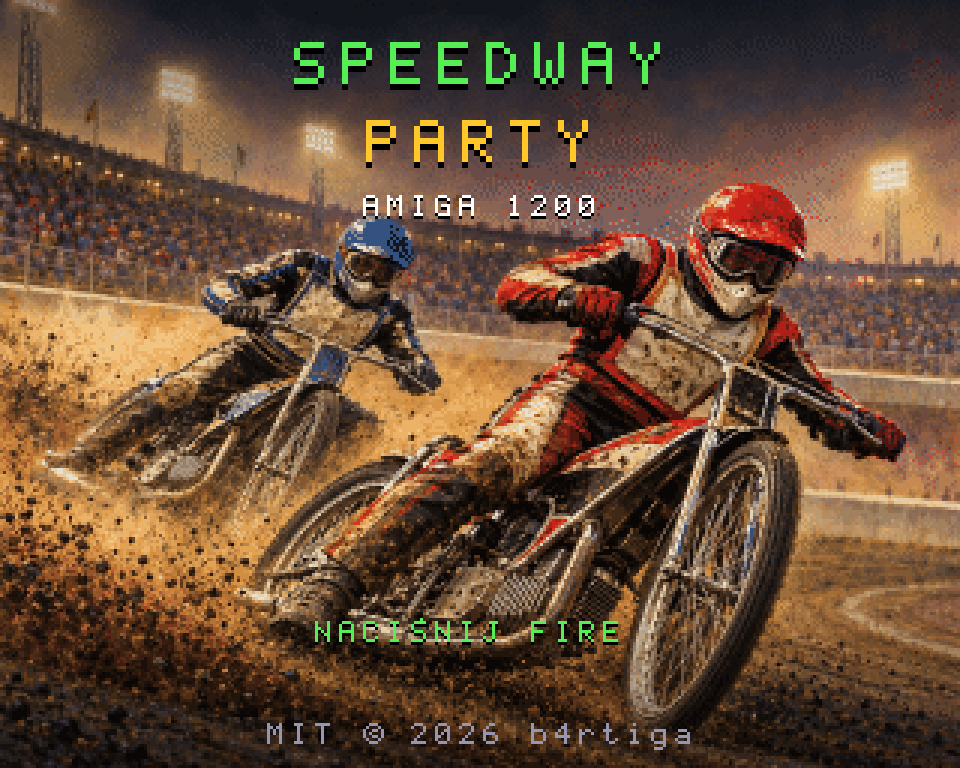 |
|---|---|

*Ekrany z gry (A1200, 68020, AGA, 2 MB Chip)*

### 🎬 Trailer
[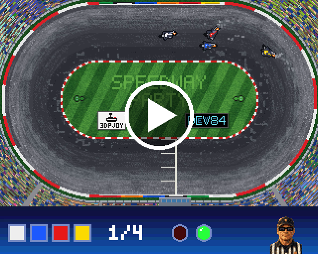](art/trailer.mp4)

Więcej ekranów (zrzuty z kodu gry skompilowanego na PC):

| | | |
|---|---|---|
|  |  |  |
|  | 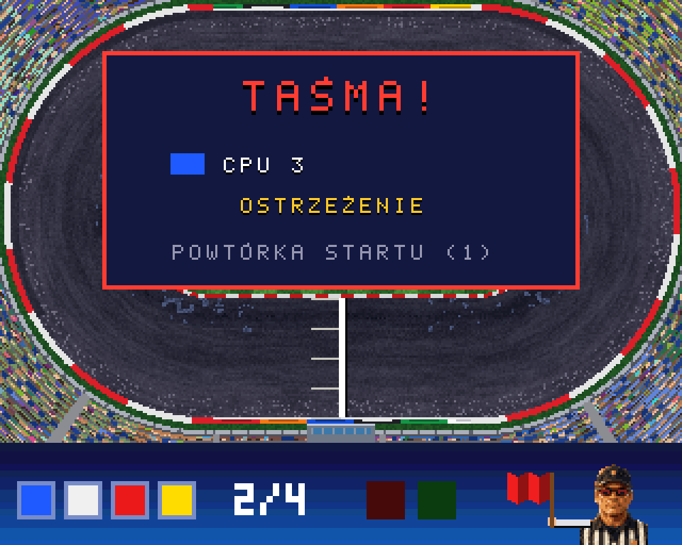 |  |
| 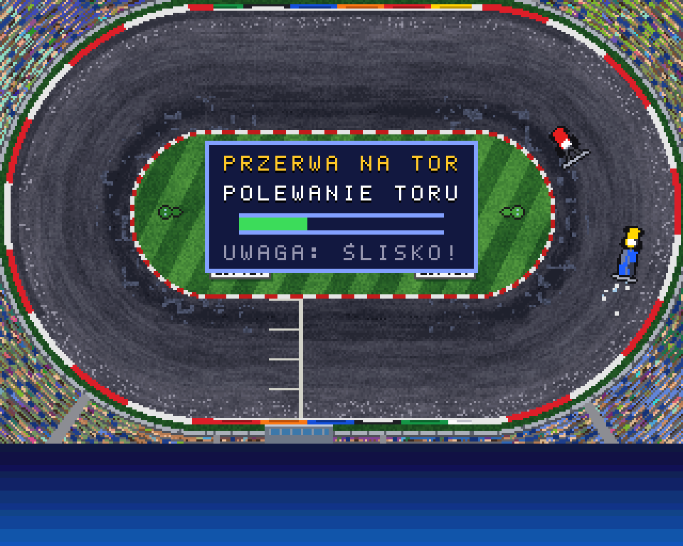 | 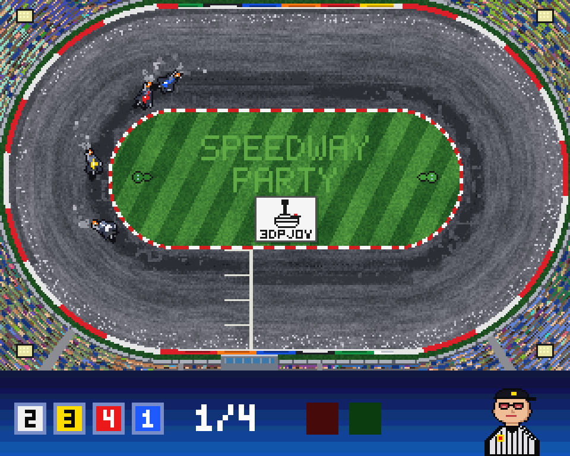 | 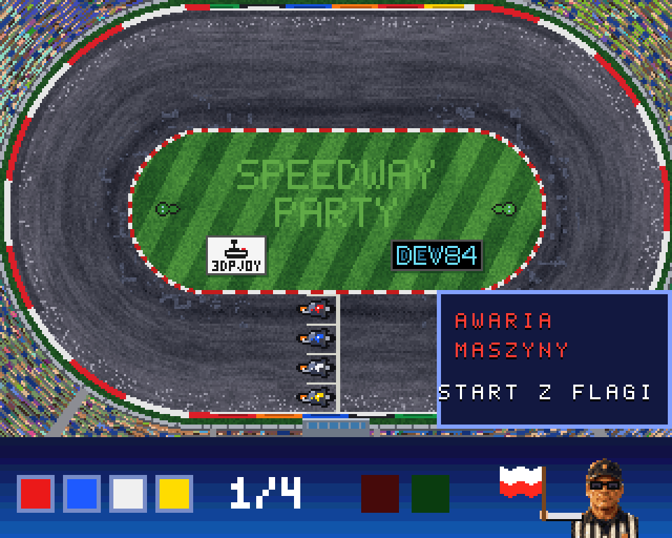 |
| 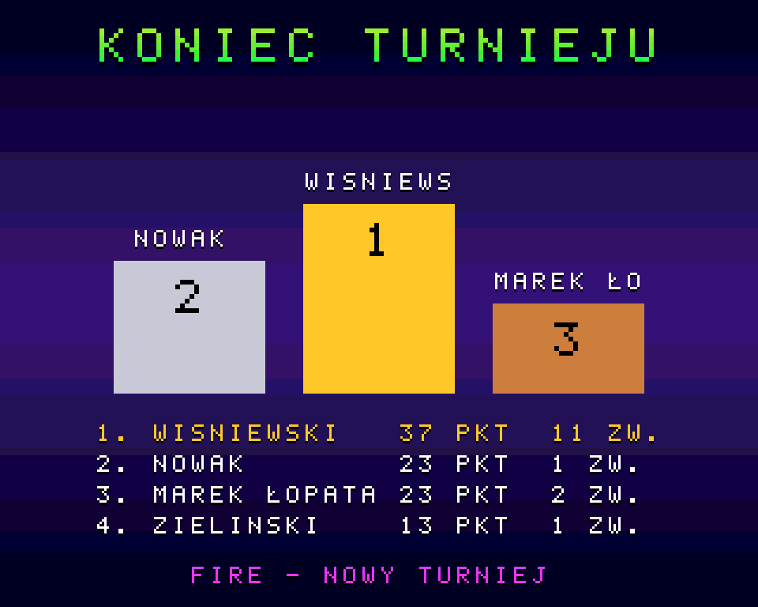 |  | 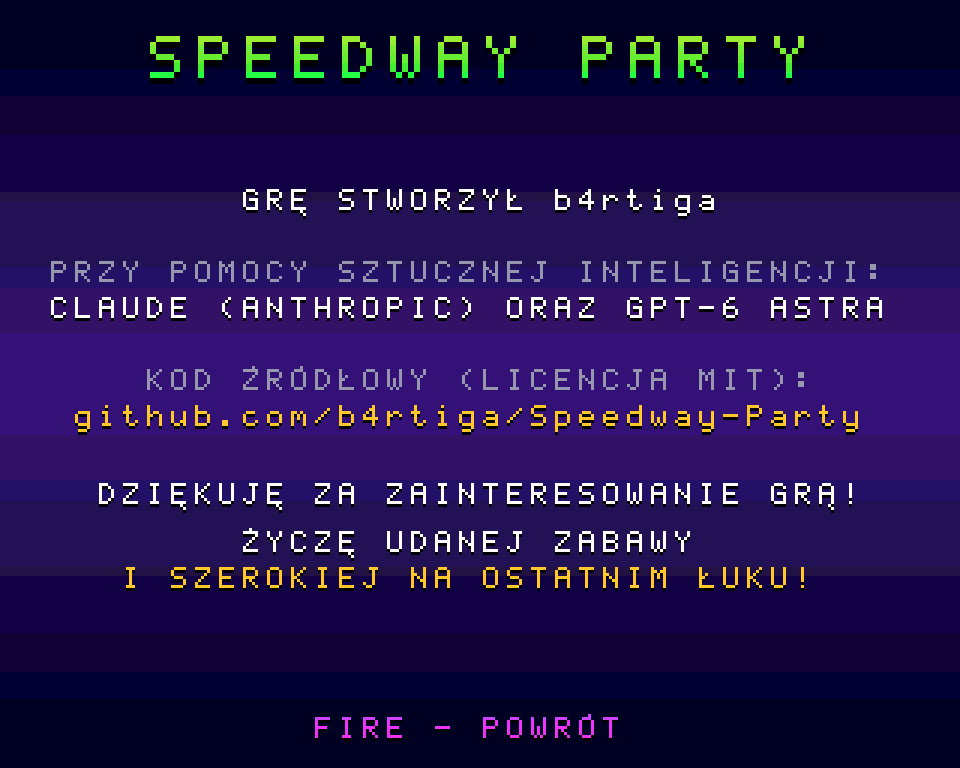 |
| 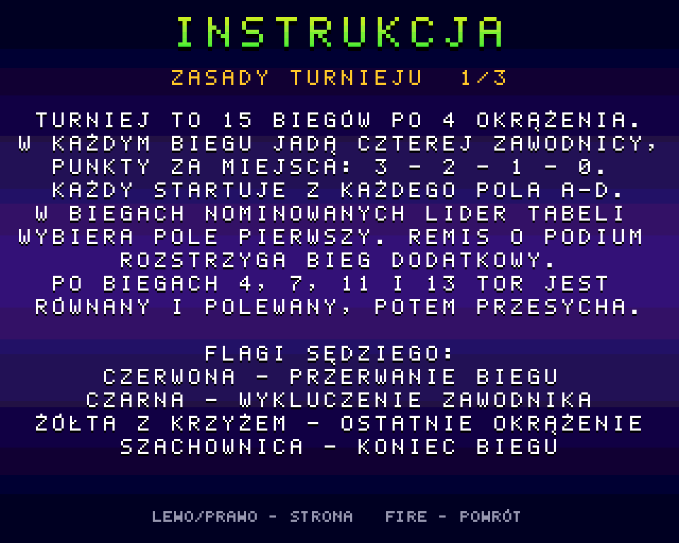 | 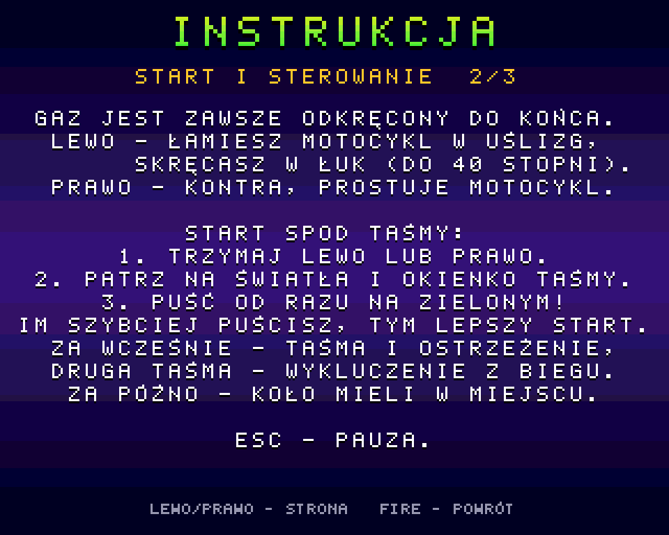 | 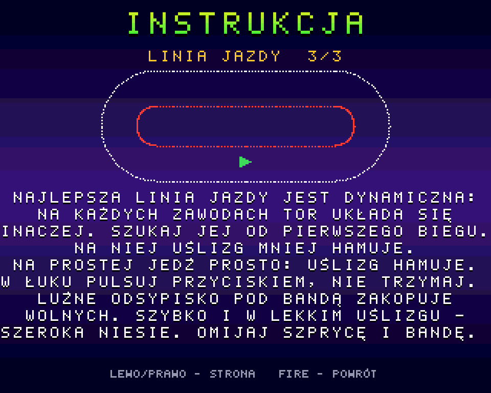 |
|  |  |  |


**Dokumentacja:** [docs/DOKUMENTACJA.md](docs/DOKUMENTACJA.md) (źródło do edycji) i [docs/SpeedwayParty-dokumentacja.pdf](docs/SpeedwayParty-dokumentacja.pdf) (PDF, `python tools/mkdocs.py`).

**English:** the game is also available in English (`SpeedwayParty_EN.adf`). Documentation in English: [docs/DOCUMENTATION.md](docs/DOCUMENTATION.md) and [docs/SpeedwayParty-documentation.pdf](docs/SpeedwayParty-documentation.pdf).

## Pobierz i zagraj

Gra jest w dwóch wersjach językowych: **polskiej** i **angielskiej** (*English version*).

**[release/SpeedwayParty_PL.adf](release/SpeedwayParty_PL.adf)** i **[release/SpeedwayParty_EN.adf](release/SpeedwayParty_EN.adf)**: startowe dyskietki (880 KB, FastFileSystem) – po polsku i po angielsku. Wkładasz dyskietkę do stacji (albo do Gotka czy emulatora) i gra rusza sama. Włożona do działającego Workbencha ma własną ikonę dysku, a na niej ikonę gry i instrukcję (`CZYTAJ.TXT` albo `README.TXT`). Dyskietka wymaga Kickstartu 2.0 lub nowszego.

**[release/SpeedwayParty.zip](release/SpeedwayParty.zip)**: obie wersje na dysk twardy lub kartę CF. W środku jest katalog `SpeedwayParty/`:

| Plik | Co to jest |
|---|---|
| `SpeedwayParty_PL` | **skompilowany program dla Amigi** (plik wykonywalny AmigaOS, bez rozszerzenia) – wersja polska |
| `SpeedwayParty_EN` | ten sam program po angielsku |
| `SpeedwayParty_PL.info`, `SpeedwayParty_EN.info` | dwie ikony – na Workbenchu wersję uruchamia podwójne kliknięcie |
| `data/` | grafika, dźwięk i muzyka (wspólne dla obu wersji); musi leżeć obok programu |
| `s/startup-sequence` | uruchamia grę (po polsku) od razu po starcie Amigi, gdy katalog jest dyskiem startowym |
| `CZYTAJ.TXT`, `README.TXT` (+ ikony) | krótka instrukcja po polsku i po angielsku |

Obok katalogu leży ikona szuflady `SpeedwayParty.info`, więc po rozpakowaniu na dysk Amigi katalog gry ma ikonę na Workbenchu. Obie wersje zapisują rekordy do tego samego pliku `halloffame.dat`.

Wymagania: Amiga 1200 lub inna z chipsetem AGA, 68020, 2 MB Chip RAM, Kickstart 3.x. Fast RAM nie jest potrzebny.
- **Na Amidze:** rozpakuj na dysk i kliknij dwa razy ikonę `SpeedwayParty_PL` (albo `SpeedwayParty_EN`) w szufladzie `SpeedwayParty` – albo w Shellu wejdź do katalogu `SpeedwayParty` i uruchom `SpeedwayParty_PL`.
- **Z dyskietki:** włóż `SpeedwayParty_PL.adf` (albo `SpeedwayParty_EN.adf`) do DF0: (w WinUAE: *Floppy drives → DF0:*) i uruchom Amigę.
- **W emulatorze z katalogu:** rozpakuj i podepnij katalog `SpeedwayParty` jako dysk startowy (szczegóły niżej w sekcji *Uruchomienie w WinUAE*).

### Na jakich Amigach działa

Gra powinna ruszyć na:

- Amidze 1200 – także na „gołej”, bez Fast RAM (2 MB Chip RAM) – z dyskietki albo z dysku twardego / karty CF,
- Amidze 1200 z kartą turbo (68030/040/060) i Fast RAM,
- Amidze 4000 i innych komputerach z chipsetem AGA i Kickstartem 3.0, 3.1 lub 3.2,
- emulatorach Amigi w konfiguracji A1200: WinUAE, FS-UAE, EmulatorJS (PUAE).

## Spis treści
1. [Mechanika gry](#mechanika-gry)
2. [Budowanie](#budowanie)
3. [Uruchomienie w WinUAE](#uruchomienie-w-winuae)
4. [Sterowanie](#sterowanie)
5. [Narzędzia na PC](#narzędzia-na-pc)
6. [Struktura projektu](#struktura-projektu)
7. [Stack technologiczny](#stack-technologiczny)
8. [Znane ograniczenia / do zrobienia](#znane-ograniczenia--do-zrobienia)
9. [Jak powstała gra](#jak-powstała-gra)

---

## Mechanika gry

> Cztery motocykle, cztery okrążenia, jedna taśma. Bez hamulców, bez biegów, bez litości.

### 🏁 Turniej, czyli wieczór na stadionie
Gracie klasyczne zawody na 15 biegów, czterech zawodników w każdym. Za zwycięstwo są 3 punkty, potem 2, 1 i nic. Program jest ułożony tak, że każdy startuje z każdego pola, więc nikt nie może narzekać na losowanie.

Każdy zawodnik ma przez cały turniej ten sam kolor kasku: czerwony, niebieski, biały albo żółty. Pole startowe zmienia się co bieg i pokazują je podprowadzające. Przed każdym biegiem, po programie zawodów, stoją na polach A–D z tablicami w kolorach kasków zawodników, którzy z nich startują, i płynnie kołyszą biodrami (3 sekundy albo FIRE).

Na koniec przychodzą **biegi nominowane**. Lider tabeli wybiera pole pierwszy, a reszta bierze to, co zostało.

Remis punktowy o miejsce na podium rozstrzyga **bieg dodatkowy**: jadą tylko zawodnicy z remisu, a pola startowe są losowane. Nie ma liczenia zwycięstw ani kombinowania, decyduje tor.

Po podium wychodzi gazeta **„GŁOS OWALU”** (wydanie specjalne): nagłówek dobrany do przebiegu zawodów (tytuł po dogrywce, zwycięstwo z rekordem toru, komplet zwycięstw, jeden punkt różnicy albo po prostu „owal ma zwycięzcę”), krótki komentarz, końcowa tabela i dwa fakty, np. liczba falstartów. Gazeta pisze tylko to, co wynika z wyników. FIRE zaczyna nowy turniej.

Przy starcie z dyskietki gra najpierw pokazuje planszę tytułową z napisem „WCZYTYWANIE…”, a resztę danych doczytuje w tle. Plansza tytułowa czeka na FIRE, potem wybierasz **JEDZIEMY!**, **INSTRUKCJA** (3 strony: zasady, start i sterowanie, linia jazdy ze schematem toru; LEWO/PRAWO zmienia stronę), **REKORDY** (tabele toru) albo **CREDITS** (plansza twórców). Z instrukcji, rekordów i twórców FIRE albo ESC wraca. Przed turniejem w ustawieniach wybierasz liczbę graczy (0–4), poziom botów, stan toru i muzykę, a kursor stoi od razu na START TURNIEJU. GRACZ 1 dostaje sterowanie z tego, czym zatwierdzisz JEDZIEMY!: joystick w porcie 0 – JOY 0, w porcie 1 – JOY 1, klawiatura (Return) – STRZAŁKI (gracz, który miał ten port, przejmuje poprzedni port gracza 1). Zawodnicy startują jako GRACZ 1, GRACZ 2… i CPU 2, CPU 3…, a każdą nazwę możesz zmienić. Po każdym biegu tabela pokazuje punkty z każdego biegu i rekordy toru.

**Rekordy toru:** 5 najlepszych biegów i 5 najlepszych okrążeń graczy (boty nie wchodzą do tabel). Gracz, który w turnieju wjedzie do piątki, wpisuje imię raz, po zawodach (po gazecie) – trafia ono do wszystkich jego miejsc; między biegami gra nie przerywa. Imię ma do 7 znaków (domyślnie pierwsze słowo nazwiska): GÓRA/DÓŁ zmienia znak, LEWO/PRAWO pozycję, można też pisać z klawiatury; FIRE albo Return zapisuje. Tabele zapisują się w pliku `halloffame.dat` obok gry (poprzednia wersja zostaje jako `halloffame.bak`) przy wyjściu z gry: ESC na ekranie wyboru i ESC jeszcze raz. Reset albo wyłączenie Amigi w trakcie gry traci wyniki z tej sesji, a na zabezpieczonej dyskietce zapis się po cichu nie udaje. Rekordy graczy ze starego pliku `records.dat` są przenoszone raz, przy pierwszym starcie.

Puste miejsca przy kanapie zajmują boty:
- **Nowicjusz** zaspał pod taśmą, łamie motocykl za mocno i trzyma się krawężnika jak tonący brzytwy.
- **Profesjonalista** ma refleks i nie zawaha się „zamknąć płotu”, gdy próbujesz go minąć po wewnętrznej.
- **Mistrz** czyta tor jak gazetę: wie, gdzie jest przyczepność, łamie dokładnie tyle, ile trzeba, a gdy trzeba, odjeżdża szeroko pod bandą.

### 🚦 Start spod taśmy
To tu wygrywa się połowę biegów. Trzymasz kierunek, ręka napięta, pali się czerwone. Czekasz sekundę, dwie, trzy, nigdy nie wiesz ile.

Zielone, brzęczyk, trzask zwolnionej taśmy, **puszczasz**. Kto puści szybciej, ten wystrzeli spod taśmy jak z procy.

Kto nie wytrzyma nerwowo i puści za wcześnie, usłyszy gwizdek: **TAŚMA!** Sędzia macha czerwoną flagą, a druga taśma w biegu oznacza wykluczenie. Kto z kolei przegapi zielone, będzie mielił kołem w miejscu, patrząc na plecy rywali.

Okrągłe światła startowe świecą w pasku na dole ekranu. Na środku ekranu, w okienku na murawie (nie zasłania zawodników na prostej), widzisz maszynę startową: lampkę i taśmę. Na zielonym taśma lekko się wygina i szybko odlatuje w górę za krawędź okienka (ok. 0,2 s), a potem okienko znika.

Raz na jakiś czas maszyna startowa odmawia posłuszeństwa: światła gasną, taśma znika, a sędzia startuje bieg **flagą narodową**. Trzeba wtedy patrzeć na jego rękę.

### 🚩 Flagi sędziego
Sędzia w rogu ekranu, w koszulce w czarno-białe pasy, pokazuje flagi jak na prawdziwych zawodach: macha nimi uniesioną ręką. Gdy nic się nie dzieje, mruga i zerka na boki zza przyciemnianych okularów.

| Flaga | Znaczenie |
|---|---|
| 🏁 szachownica | koniec biegu: od wjazdu prowadzącego na prostą startową ostatniego okrążenia, przez metę zwycięzcy, do ostatniego zawodnika. Plansza z wynikami pojawia się 2 sekundy po tym, jak metę minie ostatni |
| 🟥 czerwona | przerwanie biegu, np. po dotknięciu taśmy |
| ⬛ czarna | wykluczenie zawodnika (np. druga taśma w biegu) |
| 🟨✖️ żółta z czarnym krzyżem („kosa”) | ostatnie okrążenie: od wjazdu prowadzącego na prostą startową pod koniec 3. okrążenia do 2 s po tym, jak linię minie ostatni zawodnik |
| 🇵🇱 narodowa | awaryjny start po awarii maszyny startowej |

### 🏍️ Jazda: dwa przyciski i cała prawda o żużlu
Gaz jest zawsze odkręcony do końca. Ty decydujesz tylko o jednym: **jak mocno złamać motocykl**.

**LEWO** kładzie maszynę w uślizg, tylne koło ucieka na zewnątrz, a rama ustawia się w łuk, najwyżej pod kątem 40°. **PRAWO** to kontra: prostuje motocykl i pozwala delikatnie odbić od krawężnika. Prawdziwy żużlowiec w prawo nie skręca, więc i tutaj ta strona jest wyraźnie słabsza.

Najważniejsza zasada: **każdy stopień uślizgu kosztuje prędkość**. Motocykl złamany do oporu skręci ostro, ale zwolni o jedną czwartą. Szybcy zawodnicy nie trzymają przycisku, tylko **pulsują**: łamią na wejściu, odpuszczają w środku łuku, prostują na wyjściu i znów mają pełny gaz na prostej.

Tor nie wybacza:
- **banda** zabiera ćwierć prędkości i prostuje motocykl;
- **krawężnik** lekko spowalnia i ustawia równolegle do toru;
- **kontakt łokieć w łokieć** spowalnia obu zawodników, więc taranowanie nic nie daje i wygrywa czysta jazda.

### 🟤 Nawierzchnia, która żyje
Tor nie jest jednolity. Przy krawężniku nawierzchnia jest ubita i przyczepna, środkiem biegnie wyjeżdżona koleina, a pod bandą zbiera się luźne **odsypisko**.

To tam rodzi się najpiękniejszy manewr: **„szeroka niesie”**. Jeśli wjedziesz pod bandę z pełną prędkością i w lekkim uślizgu, odsypisko wystrzeli cię do przodu. Jeśli wjedziesz za wolno w luźne odsypisko, motocykl się w nim zakopie. Wyjeżdżona, ubita ścieżka pod bandą już nie zakopuje.

Tor **wyjeżdża się z biegu na bieg**. Każdy przejazd rozpędzonego motocykla ubija nawierzchnię (przyczepność zmienia się od razu, a ciemniejszy pas gra dorysowuje między biegami), więc linia, którą jeździ cała stawka, z biegu na bieg ciemnieje, gładnieje, trzyma coraz lepiej i robi się najszybsza. Grudki szprycy spadające obok spulchniają tor, a równarka podczas przerwy zaciera ścieżki i wszystko zaczyna się od nowa. Po polewaniu wyjeżdżona linia przesycha pierwsza. Pytanie tylko, czy wolisz jechać sprawdzoną ścieżką za rywalem, prosto w jego szprycę, czy szukać własnej drogi.

Każdy turniej to **inny tor**: na start zawodów losują się 1–2 wyjeżdżone ścieżki w innym miejscu przekroju (przy krawężniku, środkiem albo szeroko). Ubita ścieżka trzyma lepiej i widać ją jako ciemniejszy pas, więc warto ją szybko znaleźć: to ona jest idealną linią danego turnieju. Na jej środku uślizg kosztuje do 40% mniej prędkości, a im dalej od niej, tym kara za złamanie motocykla stopniowo rośnie.

Zawody odbywają się na klasycznym owalu z ciemnoszarą nawierzchnią z **bakałaru**, z linią startu na środku prostej. Na murawie stoją banery sponsorów: 3DPJOY i DEV84.

### 💧 Polewaczka, czyli tor zmienia się w trakcie zawodów
Na start turnieju **stan toru jest losowany**: suchy, wilgotny albo mokry. Jeśli wolisz inny, zmienisz go w menu.

Mokry tor ciemnieje, przy krawężniku zbierają się kałuże, a koło łapie wyraźnie gorzej. Motocykl skręca słabiej, wynosi go szerzej i trzeba łamać mocniej.

Po biegach 4, 7, 11 i 13 na tor wyjeżdżają **traktory**: jeden równa nawierzchnię, drugi ją polewa. Potem tor z biegu na bieg **przesycha**, a przyczepność powoli wraca. Linia, która wygrywała na początku zawodów, pod koniec może już nie działać.

### 🌪️ Szpryca
Każdy motocykl w uślizgu sypie spod tylnego koła **szprycę**, czyli wachlarz nawierzchni lecący do tyłu i na zewnątrz łuku.

Jedziesz tuż za rywalem? Dostajesz nią prosto w twarz i tracisz prędkość, metr po metrze. Siedzenie komuś na kole nic nie da: trzeba znaleźć **czystą linię**, wyjść z jego szprycy i zaatakować z boku. Tak samo jak na prawdziwym torze.

---

## Budowanie

### 1. Toolchain Bebbo (amiga-gcc)
Najprościej na Windows przez **WSL2 z Ubuntu**. Sam toolchain buduje się raz, ok. 30–60 min:

```bash
sudo apt update
sudo apt install make wget git gcc g++ lhasa libgmp-dev libmpfr-dev libmpc-dev flex bison gettext texinfo ncurses-dev autoconf rsync libreadline-dev
git clone https://github.com/bebbo/amiga-gcc
cd amiga-gcc
make update
make all -j4 PREFIX=$HOME/amiga-gcc
echo 'export PATH=$HOME/amiga-gcc/bin:$PATH' >> ~/.bashrc
```

Sprawdzenie: `m68k-amigaos-gcc --version`. NDK 3.9 i libnix są w toolchainie, nic więcej nie trzeba.

Aktualną listę zależności znajdziesz w README repozytorium [bebbo/amiga-gcc](https://github.com/bebbo/amiga-gcc).

### 2. Gra
W WSL, w katalogu projektu (np. `/mnt/e/Workshop/Speedway Party`):

```bash
make dist
```

Powstaje katalog `dist/`:
```
dist/SpeedwayParty          plik wykonywalny
dist/data/*                 grafika, dźwięk, muzyka - ładowane z PROGDIR:data/
dist/s/startup-sequence     uruchamia grę od razu po starcie Amigi
```

Gotowe dane (`data/`) są w repozytorium. Do budowania nie potrzebujesz Pythona.

**Muzyka w menu** jest wybierana przed kompilacją w pliku [build.cfg](build.cfg):

```
MUSIC = BlackMotor
```

| Wartość | Utwór |
|---|---|
| `BlackMotor` | „Black Motor”, 13,3 s, 208 KiB (domyślnie) |
| `NightGrid` | „Night Grid”, 27,4 s, 428 KiB |
| `BRAK` | gra bez muzyki, oszczędza Chip RAM |

Utwory leżą w `src/music/<nazwa>/` jako gotowe miksy `*_s8.raw` (PCM 8 bit mono, ~16 kHz PAL). `make dist` kopiuje wybrany do `data/music.raw`. Jednorazowo możesz też podać utwór w poleceniu: `make dist MUSIC=NightGrid`. Nowy utwór to nowy katalog w `src/music/` z plikiem `*_s8.raw`.

---

## Uruchomienie w WinUAE

1. **Quickstart → Model: A1200**, konfiguracja z Kickstartem 3.0 lub 3.1. ROM musisz mieć własny, np. z Amiga Forever.
2. **CPU and FPU:** 68020, *cycle-exact* (najwierniejszy czas, ważny dla stałych 50 FPS). Bez FPU.
3. **RAM:** Chip 2 MB, Slow 0, Fast 0. Testujemy bez Fast RAM, tak jak na gołym A1200.
4. **Chipset:** AGA, PAL.
Gotowa konfiguracja jest w [tools/winuae/SpeedwayParty-A1200.uae](tools/winuae/SpeedwayParty-A1200.uae): wpisz w niej ścieżkę do swojego `dist/` i wczytaj ją w WinUAE (*Configurations → Load*) albo uruchom `winuae64.exe -f SpeedwayParty-A1200.uae`. Ręcznie:

5. **CD & Hard drives → Add Directory or Archive…**: wskaż katalog `dist/`.
   - *Device name*: `DH0`, *Volume label*: `Speedway`
   - *Boot priority*: 0 lub wyżej (katalog ma być dyskiem startowym)
6. **Game ports:** port 1 = joystick (klawiatura lub pad), port 0 = drugi joystick (np. joystick USB) w trybie **Joystick**, nie myszy, jeśli gra 2+ graczy. **Nie zostawiaj myszy w porcie 0**, bo kursor w menu będzie skakał.
7. Start. Kickstart uruchomi `s/startup-sequence`, a ten od razu grę. Workbench nie jest potrzebny.
8. **Obraz na całe okno:** w szablonie konfiguracji okno ma 640×512 (obraz gry 320×256 powiększony 2×), a obraz jest wycentrowany (`gfx_center_horizontal/gfx_center_vertical=smart`; starsze nazwy `gfx_xcenter/gfx_ycenter` nowe WinUAE pomija i obraz był przesunięty o 9 pikseli w prawo z uciętą prawą krawędzią), więc gra wypełnia okno bez ramki. Ramkę wokół obrazu gra i tak wygasza (bit BRDRBLNK w AGA).

Jeśli wolisz Workbench: podepnij `dist/` jako dodatkowy dysk i w Shellu wpisz `cd Speedway:` i `SpeedwayParty`.

**ESC** (albo drugi przycisk joysticka) to pauza z pytaniem. W trakcie turnieju gra pyta, czy wrócić do menu głównego, w ustawieniach wraca od razu do ekranu wyboru, a na ekranie wyboru i planszy tytułowej pyta, czy zakończyć grę. Drugie ESC oznacza „tak”, a FIRE wraca do gry.

Przy **0 graczach** cały turniej jadą boty: to tryb pokazowy.

### Gdy coś nie działa
| Objaw | Gdzie szukać |
|---|---|
| Obraz „poszatkowany”, przesunięty o 64 px | `DDF_STOP` i `MOD_ADJ` w `src/video.c` (pobieranie bitplanów w trybie 4×). W WinUAE działa `$38/$A0`. Do testów: `make dist EXTRA=-DDDF_STOP=0xD0` |
| Joystick w porcie 0 (JOY 0) łapie tylko lewo, nie łapie prawa, „rusza” przy puszczeniu do środka | emulator podaje joystick w porcie 0 jako mysz: ustaw dla portu 0 tryb **Joystick** (WinUAE: *Game ports*, w konfiguracji `joyport0=joy0`, `joyport0mode=djoy`, jak w szablonie; w innym emulatorze analogicznie) |
| Menu samo się przełącza | mysz w porcie 0: menu czyta tylko port 1 i klawiaturę, ale gracz 2 ustawiony na JOY 0 będzie „jechał” myszą |
| Zamiast grafiki są proste kształty | brak `data/` obok programu (gra wtedy rysuje grafikę zastępczą) |
| Brak dźwięku | brak `data/*.raw` |
| Brak muzyki w menu | `MUSIC = BRAK` w `build.cfg`, brak `data/music.raw` albo opcja MUZYKA: NIE w ustawieniach |
| Gracze 3–4 na adapterze LPT nie reagują | bity adaptera w `src/input.c`, oznaczone „sprawdzić” |
| Strzałki nie działają, bieg czeka na start | w szablonie WinUAE (`joyport1=kbd2`) strzałki i prawy Ctrl emulują **joystick w porcie 1**. Ustawienia **JOY 1** i **STRZAŁKI** czytają oba źródła (joystick w porcie 1 i strzałki z klawiatury), chyba że drugie wybrał inny gracz. Gdy bieg czeka na gracza, który nie trzyma kierunku, gra pokazuje podpowiedź |

---

## Sterowanie

Każdy gracz ma tylko **LEWO i PRAWO**. Gaz jest automatyczny.

| | Gracz 1 | Gracz 2 | Gracz 3 | Gracz 4 |
|---|---|---|---|---|
| domyślnie | joystick port 1 | joystick port 0 | klawisze **Z / X** | klawisze **N / M** |
| do wyboru w menu | + adapter 4 graczy (LPT), strzałki (JOY 1 i strzałki działają zamiennie, jeśli nikt inny ich nie używa) | | | |

- **Start spod taśmy:** trzymaj dowolny kierunek. Na zielonym świetle **puść**. Puszczenie przed zielonym to taśma (falstart). Trzymanie dłużej niż 0,3 s po zielonym to mielenie kołem w miejscu.
- **Jazda:** LEWO łamie motocykl w łuk (do 40°), PRAWO to kontra (do ok. 14°, głównie prostuje). Szczegóły w sekcji [Mechanika gry](#mechanika-gry).
- **Szeroka niesie:** pod bandą, z pełną prędkością i w lekkim uślizgu motocykl dostaje dodatkowe przyspieszenie. Za wolno pod bandą motocykl się zakopuje.
- **Szpryca:** jazda tuż za rywalem w uślizgu lekko spowalnia. Szukaj czystej linii.
- **Menu:** joystick w porcie 1 albo 0 (góra/dół/lewo/prawo, FIRE = zatwierdź) albo strzałki i Return. **Drugi przycisk** joysticka działa jak ESC (pauza z pytaniem, powrót z instrukcji i twórców).
- **Joystick w porcie 0** musi być w emulatorze ustawiony w trybie joysticka, nie myszy (WinUAE: *Game ports*). Zawodnicy nazywają się na start GRACZ 1, GRACZ 2… (sterowani przez ludzi) i CPU 2, CPU 3… (boty), zależnie od liczby graczy. Nazwisko edytujesz z klawiatury, polskie litery przez Alt (Alt+X = Ź, Alt+Z = Ż).
- Liczbę graczy zmieniasz w pierwszym wierszu ekranu ustawień (LEWO/PRAWO).

---

## Narzędzia na PC

Wymagają Pythona 3 z `numpy`, a sprawdzanie kodu i symulator także `pip install ziglang`.

| Polecenie | Co robi |
|---|---|
| `make assets` | regeneruje grafikę (`tools/genart.py`, `tools/gentitle.py`, `tools/gengirls.py`), dźwięk (`tools/genaudio.py`), font (`tools/genfont.py`); robocze podglądy (makiety, arkusze klatek, WAV) trafiają do `build/preview/` poza repo |
| `make dist-en` | katalog `dist-en/` z wersją angielską (program z `-DLANG_EN`, obiekty w `build/en/`; napisy obu wersji stoją obok siebie w kodzie jako `T("po polsku", "in English")`) |
| `make release` | buduje paczkę `release/SpeedwayParty.zip` (obie wersje językowe) i startowe dyskietki `release/SpeedwayParty_PL.adf` i `release/SpeedwayParty_EN.adf` (`tools/mkadf.py`, bez zewnętrznych narzędzi) |
| `python tools/mkicons.py preview` | ikony Workbencha (`tools/mkicons.py`: gra, szuflada, dysk, instrukcja; klasyczny format OS 2.x/3.x, 4 kolory) – podgląd w `build/preview/icon_*.png`; ikony do paczek dokłada `make dist` / `make release` |
| `make whdload` | wersja WHDLoad (w przygotowaniu, nie wchodzi do wydania): gra z `-DWHDLOAD` bez systemu (`src/whd.c`, `src/whdstart.s`) i slave `tools/whdload/slave.s` w katalogu `dist-whd/`; czeka na test z oryginalnym Kickstartem 3.1 |
| `sh tools/sim/pack_test.sh` | test rozpakowywania: pliki spakowane przez `tools/pack.py` wczytane przez `asset_load` z gry = dane z `data/`, uszkodzone odrzucone |
| `python tools/gentitle.py` | plansza tytułowa z ilustracji `src/title.png`: kadr 320×256, własna paleta AGA i dithering (`data/title.bpl`, `data/title.pal`) |
| `python tools/genreferee.py` | portret sędziego w HUD z ilustracji `src/referee.png`: 32×38, własne odcienie w wolnych kolorach palety HUD, oraz malowana ręka z pięścią w dwóch fazach machania flagą (`data/refarm.bin`; używa go `tools/genart.py`; wymaga ffmpeg) |
| `python tools/gengirls.py` | podprowadzające z ilustracji `src/girls.png`: cztery postacie 48×96, wspólna paleta 31 kolorów dobrana z obrazu, kolory pól z UI, lekki dithering (`data/girls.bin`; wymaga ffmpeg) |
| `make check` | sprawdza składnię i typy całego kodu Clangiem dla 68020 (atrapy NDK w `tools/ndkstub/`) |
| `make sim` | symulator: te same pliki logiki gry rozgrywają turniej botów bez grafiki |
| `sh tools/sim/news_test.sh` | test gazety: wybór nagłówka na scenariuszach, podsumowanie turnieju, zerowanie faktów, długie nazwiska |
| `sh tools/sim/records_test.sh` | test tabel rekordów: TOP 5, remisy, imiona, plik `halloffame.dat` (także uszkodzony i starsza wersja) |
| `sh tools/sim/sprites_test.sh` | test klatek motocykli: jeden komplet + kolor kasku nadany przy kopiowaniu = dawne 4 komplety z `v0.84`, bit w bit |
| `sh tools/sim/start_test.sh [turnieje]` | uczciwość startu: 4 jednakowe boty, wyniki według pola startowego A–D |
| `sh tools/sim/batch.sh` | 5 turniejów, średnie punkty dla każdego poziomu AI (do strojenia) |
| `python tools/sim/plot.py` | tory jazdy z symulacji na tle toru, zapis do `art/sim_lines.png` |
| `sh tools/shots/run.sh` | zrzuty ekranu z prawdziwego kodu gry (UI, HUD, duszki, szpryca, traktory) skompilowanego na PC, zapis do `art/screen_*.png` |
| `python tools/import_engine.py plik.wav` | robi pętlę silnika dla Pauli z nagrania (obecnie `src/speedway_500cc_10000rpm_loop.wav`; `make assets` robi to sam) |
| `python tools/mkdocs.py` | dokumentacja: `docs/DOKUMENTACJA.md` → `docs/SpeedwayParty-dokumentacja.pdf` (HTML do druku, PDF drukuje Edge albo Chrome w tle; wersja z gita) |
| `python tools/mksocial.py` | miniaturka do podglądu linków na GitHubie, `art/social_preview.jpg` (1280×640, poniżej limitu 1 MB; wymaga ffmpeg) |
| `sh tools/mktrailer.sh` | trailer `art/trailer.mp4` z prawdziwego kodu gry: menu, start i jedno okrążenie biegu z dźwiękiem silników (logika `audio.c`, mikser `tools/trailer_audio.py`) i przejście do ilustracji tytułowej (wymaga ffmpeg) |
| `make dist EXTRA=-DAUTOPLAY` | wersja testowa bez klawiatury: sama przechodzi przez menu i rozgrywa turniej botów (do sprawdzania w emulatorze) |
| `make dist EXTRA=-DSHOW_LAG` | wersja pomiarowa: w HUD zgubione klatki biegu i szczytowy czas (w liniach obrazu z 313) części logiki biegu: motocykle i boty, szpryca, tor, cała logika |
| `make dist EXTRA="-DSHOW_LAG -DSHOW_START"` | pomiar startu spod taśmy: zgubione klatki w oknie odlotu taśmy i szczytowe czasy logiki, rysowania oraz duszków+HUD w tym oknie |

Geometria toru jest zapisana w dwóch miejscach: `track_defs` w `src/track.c` i `PRESETS` w `tools/genart.py`. Wartości (`HALF_L, R_IN, R_OUT`) muszą być identyczne.

---

## Struktura projektu

```
src/
  main.c        pętla 50 Hz, maszyna stanów turnieju
  system.c      przejęcie i oddanie sprzętu, własne przerwanie VBL
  video.c       Copper-listy AGA: 8 bitplanów, paleta 24-bit, kolory per linia, HUD, podwójny bufor
  sprites.c     duszki 32 px (pary attached), klatki motocykli (1 komplet), kopia na motocykl i bufor z kolorem kasku, pozycja co 1/4 px
  blit.c        Blitter: wypełnianie, kopiowanie, kropki „cookie-cut” (szpryca)
  start.c       procedura startowa, taśma, refleks
  race.c        model jazdy: auto-gaz, uślizg, banda, kontakt, okrążenia
  ai.c          boty: Nowicjusz / Profesjonalista / Mistrz
  roost.c       szpryca i woda z polewaczki (cząsteczki Blittera)
  track.c       geometria owalu, mapa przyczepności, wilgotność, wyjeżdżone ścieżki (przemalowanie w kolejce)
  tractors.c    przerwa na tor (traktory na duszkach)
  tournament.c  tabela 15 biegów, punkty, biegi nominowane
  ui.c, text.c  ekrany tekstowe, font z polskimi literami
  hud.c         HUD: kolory kasków w kolejności, okrążenie, okrągłe światła, sędzia z flagą
  audio.c       Paula: silniki, kibice, brzęczyk, gwizdek, okrzyk trybun na ostatniej prostej, muzyka w menu
  input.c       joysticki, adapter LPT, klawiatura (CIA)
  assets.c      ładowanie data/ przed przejęciem sprzętu, rozpakowywanie plików spakowanych na dyskietce (tools/pack.py)
  records.c     rekordy toru na dysku (halloffame.dat + .bak, import starego records.dat)
  hof.c         tabele TOP 5 biegów i okrążeń, imiona graczy, format pliku (test: tools/sim/records_test.sh)
  newspaper.c   gazeta po zawodach: migawka turnieju, wybór nagłówka i faktów
  music/        utwory do menu (gotowe miksy *_s8.raw), wybór w build.cfg
  banners/      logo na banery (źródło SVG)
build.cfg       ustawienia budowania (wybór muzyki)
data/           gotowe dane binarne (generowane narzędziami)
art/            podglądy PNG/WAV (nie trafiają na Amigę)
docs/           dokumentacja: DOKUMENTACJA.md (źródło) i PDF
tools/          generatory, sprawdzanie kodu, symulator
```

---

## Stack technologiczny

| Obszar | Czego używamy |
|---|---|
| Platforma docelowa | Amiga 1200: 68020, chipset AGA, 2 MB Chip RAM, bez Fast RAM, PAL 50 Hz, Kickstart 2.0+ (dyskietka) / 3.x |
| Język i sprzęt | C (gnu99) bez bibliotek gry: gra przejmuje system i sama programuje układy AGA - Copper (8 bitplanów, paleta 24-bit, kolory per linia), Blitter, duszki 32 px (pary attached, pozycja co 1/4 px), Paula (4 kanały, muzyka w podwójnym buforze), CIA (klawiatura, joysticki, adapter LPT) |
| Kompilator | Bebbo amiga-gcc 6.5.0b (`m68k-amigaos-gcc -m68020 -O2 -fbbb=- -noixemul`), NDK 3.9, libnix; `make` w WSL2 (Ubuntu) |
| Emulator i pomiary | WinUAE (A1200, 68020 cycle-exact, AGA, 2 MB Chip, ROM AROS); wersje testowe `AUTOPLAY` (turniej botów bez klawiatury) i `SHOW_LAG` / `SHOW_START` (zgubione klatki i czasy w liniach obrazu w HUD) |
| Narzędzia na PC | Python 3 + numpy: tor, motocykle, traktory, HUD, font, palety, konwersja ilustracji do palet AGA, dźwięki, dyskietka ADF i paczka zip; ffmpeg: dekodowanie PNG, trailer MP4, miniaturka JPG |
| Sprawdzanie i testy | Clang z pakietu `ziglang`: kontrola typów kodu dla 68020 (atrapy NDK), symulator turnieju z tą samą logiką gry, zrzuty ekranu i trailer z prawdziwego kodu gry (emulacja buforów i duszków), testy gazety |
| Grafika | pikselart toru, motocykli, traktorów i HUD generowany kodem; ilustracje (plansza tytułowa, podprowadzające, sędzia) przygotowane generatorem obrazów AI i przekonwertowane do palet gry narzędziami z repozytorium |
| Dźwięk | silnik z nagrania wygenerowanego przez AI (pętla 8 cykli zapłonu); kibice, brzęczyk z taśmą, gwizdek i okrzyk trybun (gdy prowadzący wjeżdża na ostatnią prostą) generowane w Pythonie (okrzyk można podmienić nagraniem `src/crowd_cheer.wav`); utwory menu jako gotowe miksy PCM 8-bit ~16 kHz |
| Repozytorium i praca | git, GitHub; asystenci AI: Claude (Anthropic) i GPT-6 Astra |

---

## Znane ograniczenia / do zrobienia

### Stan
- Gra kompiluje się Bebbo GCC 6.5.0b bez ostrzeżeń i działa w WinUAE (A1200, 68020 cycle-exact, AGA, 2 MB Chip RAM, ROM AROS): plansza tytułowa, menu, turniej, biegi, polewanie, dźwięk i muzyka w menu. Menu i bieg chodzą w 50 FPS: według pomiaru w WinUAE w całym biegu (4 okrążenia) gubią się pojedyncze klatki (kilka w chwili odlotu taśmy i przy zmianie flagi). Pomiar daje wersja `make dist EXTRA=-DSHOW_LAG` (liczby w HUD).
- **Nie była jeszcze testowana na prawdziwym A1200 ani z oryginalnym Kickstartem 3.1.** Zgłoszenia z prawdziwego sprzętu są bardzo mile widziane.
- Logikę (fizykę, boty, turniej) sprawdza symulator na PC (`make sim`). Prawdziwi gracze dopiero ocenią, jak sterowanie dwoma przyciskami czuje się w rękach, i parametry jazdy mogą się jeszcze zmienić.
- Gra zajmuje ok. 1,05–1,25 MB Chip RAM (tor, motocykle, traktory, plansza tytułowa, dźwięk i muzyka: 208 KiB „Black Motor” albo 428 KiB „Night Grid”), więc potrzebuje A1200 z 2 MB Chip. Klatki motocykli to jeden komplet (51 KiB) – kolor kasku zawodnika gra nadaje przy kopiowaniu klatki. Na Amidze z Fast RAM muzyka i klatki motocykli lądują w Fast RAM.

### Znane ograniczenia
- **Silniki słychać tylko dwa naraz:** Paula ma 4 kanały, a pozostałe dwa zajmują kibice i efekty. Grają dwaj najwyżej sklasyfikowani zawodnicy, którzy jeszcze jadą; ci za metą dopiero wtedy, gdy na torze zostało mniej niż dwóch.
- **Dźwięk silnika** to pętla z nagrania 500 cm³ na 10 000 obr/min wygenerowanego przez AI (`src/speedway_500cc_10000rpm_loop.wav`, import: `tools/import_engine.py`). Wysokość tonu w grze zmienia Paula zależnie od obrotów.
- **Mysz w porcie 0:** menu jej nie czyta, ale gracz 2 ustawiony na „JOY 0” z myszą zamiast joysticka będzie „jechał” ruchami myszy.
- **Adapter 4 graczy na porcie równoległym** nie był testowany. Przypisanie bitów w `src/input.c` może wymagać poprawki.
- **Remis punktowy poza podium** (o 4. miejsce) rozstrzygają zwycięstwa biegów. O podium zawsze rozstrzyga bieg dodatkowy.
- **Boty** jeżdżą głównie wewnętrzną połową toru. Szeroka linia pod bandą to szansa dla ludzi.
- Tylko **PAL** (50 Hz).

### Do zrobienia
- tryb treningu: pojedynczy bieg albo jazda na czas
- więcej torów i stadionów
- test na prawdziwym A1200 i z oryginalnym Kickstartem 3.1
- ostatnie zgubione klatki w chwili startu spod taśmy
- sprawdzenie zapisu rekordów toru (`halloffame.dat`) na prawdziwej Amidze

---

## Jak powstała gra
Speedway Party została stworzona przez b4rtiga przy pomocy sztucznej inteligencji: **Claude** (Anthropic) oraz **GPT-6 Astra**.

---

## Licencja
[MIT](LICENSE) © 2026 b4rtiga
