# Speedway Party – dokumentacja

Zręcznościowa gra żużlowa na Amigę 1200 (AGA). Turniej 15 biegów dla 1–4 graczy przy jednym ekranie, wolne miejsca zajmują boty.

> Ten plik jest źródłem dokumentacji. Edytuj go jak zwykły tekst (Markdown), a PDF zrób poleceniem `python tools/mkdocs.py` (szczegóły w rozdziale *Jak aktualizować tę dokumentację*). Wersja i data w PDF biorą się same z gita. Wersja angielska: `docs/DOCUMENTATION.md` i `docs/SpeedwayParty-documentation.pdf`.

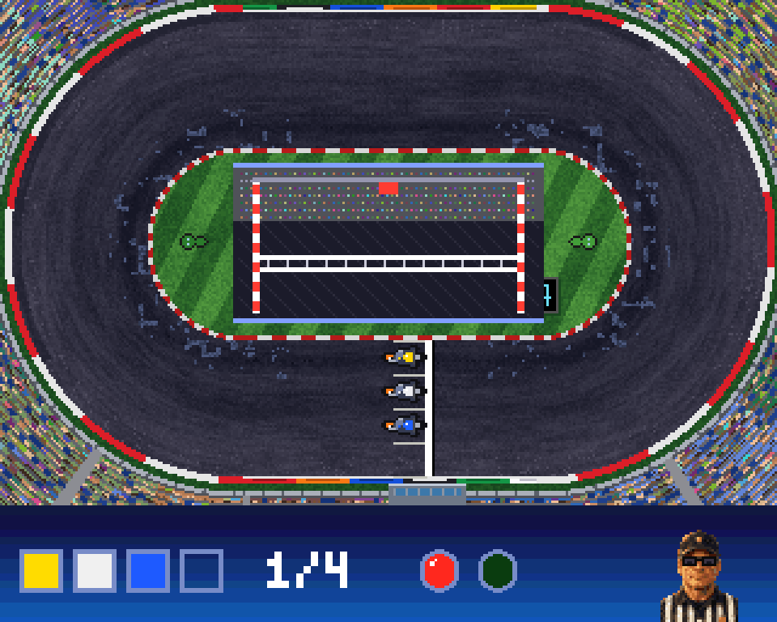

# Część I. Dla gracza

## 1. Wymagania i instalacja

**Wymagania:** Amiga 1200 lub inna z chipsetem AGA, procesor 68020, 2 MB Chip RAM, Kickstart 3.x (dyskietka startuje już od Kickstartu 2.0). Fast RAM nie jest potrzebny. Obraz tylko w PAL (50 Hz).

Gra ma dwie wersje językowe – polską i angielską – i jest dostępna w trzech plikach (katalog `release/` w repozytorium):

| Plik | Co to jest |
|---|---|
| `SpeedwayParty_PL.adf` | startowa dyskietka 880 KB (FastFileSystem) z wersją polską. Wkładasz ją do stacji DF0: (albo do Gotka czy emulatora) i gra rusza sama. |
| `SpeedwayParty_EN.adf` | to samo po angielsku. |
| `SpeedwayParty.zip` | obie wersje na dysk twardy: katalog `SpeedwayParty/` z ikoną szuflady, programy `SpeedwayParty_PL` i `SpeedwayParty_EN` z ikonami, wspólne dane `data/`, `s/startup-sequence` i krótka instrukcja `CZYTAJ.TXT` / `README.TXT` z ikonami. |

**Uruchomienie:**

- **Z dyskietki:** włóż `SpeedwayParty_PL.adf` (albo `SpeedwayParty_EN.adf`) do DF0: i włącz Amigę (w WinUAE: *Floppy drives → DF0:*).
- **Z twardego dysku:** rozpakuj zip na dysk Amigi i na Workbenchu kliknij dwa razy ikonę `SpeedwayParty_PL` (albo `SpeedwayParty_EN`) w szufladzie `SpeedwayParty` – albo w Shellu wejdź do katalogu `SpeedwayParty` i wpisz `SpeedwayParty_PL`. Katalog `data/` musi leżeć obok programu. Obie wersje mają wspólne rekordy.
- **W emulatorze z katalogu:** podepnij rozpakowany katalog jako dysk startowy (rozdział 9).

Gra powinna ruszyć na:

- Amidze 1200 – także na „gołej”, bez Fast RAM (2 MB Chip RAM) – z dyskietki albo z dysku twardego / karty CF,
- Amidze 1200 z kartą turbo (68030/040/060) i Fast RAM,
- Amidze 4000 i innych komputerach z chipsetem AGA i Kickstartem 3.0, 3.1 lub 3.2,
- emulatorach Amigi w konfiguracji A1200: WinUAE, FS-UAE, EmulatorJS (PUAE).

**ESC** (albo drugi przycisk joysticka) w dowolnym momencie otwiera pauzę z pytaniem: w turnieju – czy wrócić do menu, na ekranie wyboru – czy zakończyć grę. W ustawieniach ESC wraca od razu do ekranu wyboru. Drugie ESC oznacza „tak”, FIRE wraca do gry.

## 2. Sterowanie

Każdy gracz ma tylko dwa przyciski: **LEWO** i **PRAWO**. Gaz jest automatyczny.

| | Gracz 1 | Gracz 2 | Gracz 3 | Gracz 4 |
|---|---|---|---|---|
| domyślnie | joystick w porcie 1 | joystick w porcie 0 | klawisze Z / X | klawisze N / M |
| do wyboru | strzałki, adapter 4 graczy (LPT) | | | |

- Ustawienia **JOY 1** i **STRZAŁKI** działają zamiennie (joystick w porcie 1 albo strzałki), chyba że drugie wybrał inny gracz.
- **Menu:** joystick w porcie 1 albo 0 (góra/dół/lewo/prawo, FIRE = zatwierdź) albo strzałki i Return.
- **Drugi przycisk joysticka** działa jak ESC: pauza z pytaniem, powrót z instrukcji i twórców.
- **Joystick w porcie 0** musi być w emulatorze ustawiony w trybie joysticka, nie myszy.
- **Nazwiska** edytujesz z klawiatury, polskie litery przez Alt (np. Alt+X = Ź, Alt+Z = Ż).

## 3. Ekrany gry

### Plansza tytułowa i wybór

Przy starcie z dyskietki wczytywanie trwa kilkadziesiąt sekund, więc gra najpierw pokazuje planszę tytułową z napisem „WCZYTYWANIE…”, a resztę danych doczytuje w tle (system działa jeszcze normalnie, gra przejmuje sprzęt dopiero po wczytaniu). Plansza tytułowa czeka na FIRE. Potem wybierasz:

- **TURNIEJ** – zawodnicy i ustawienia turnieju,
- **INSTRUKCJA** – trzy strony: zasady turnieju i flagi, start i sterowanie, linia jazdy ze schematem toru (LEWO/PRAWO zmienia stronę),
- **REKORDY** – tabele rekordów toru,
- **CREDITS** – plansza twórców.

Z instrukcji, rekordów i twórców wracasz FIRE albo ESC.

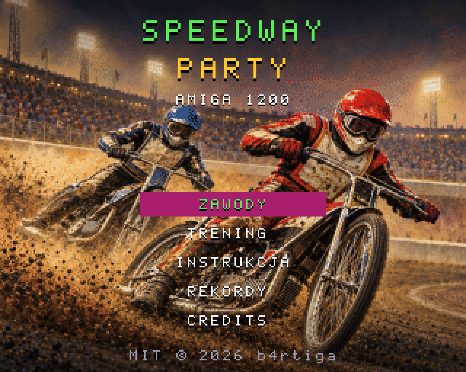

### Turniej: zawodnicy i ustawienia

Liczba graczy (0–4), sterowanie i nazwiska graczy oraz poziom botów. Wiersz **USTAWIENIA** otwiera osobny ekran: stan toru na start (suchy, wilgotny, mokry albo losowy – domyślnie), pora (dzień albo noc – rozdział 6), defekty (rozdział 4) i muzyka; LEWO/PRAWO albo FIRE zmienia, POWRÓT albo ESC wraca do ekranu turnieju. Pod listą widać skrót wybranych ustawień. Kursor stoi od razu na **START TURNIEJU**. GRACZ 1 dostaje sterowanie z tego, czym zatwierdzisz TURNIEJ: joystick w porcie 0 – JOY 0, w porcie 1 – JOY 1, klawiatura (Return) – STRZAŁKI (gracz, który miał ten port, przejmuje poprzedni port gracza 1). Przy 0 graczach cały turniej jadą boty – to tryb pokazowy.

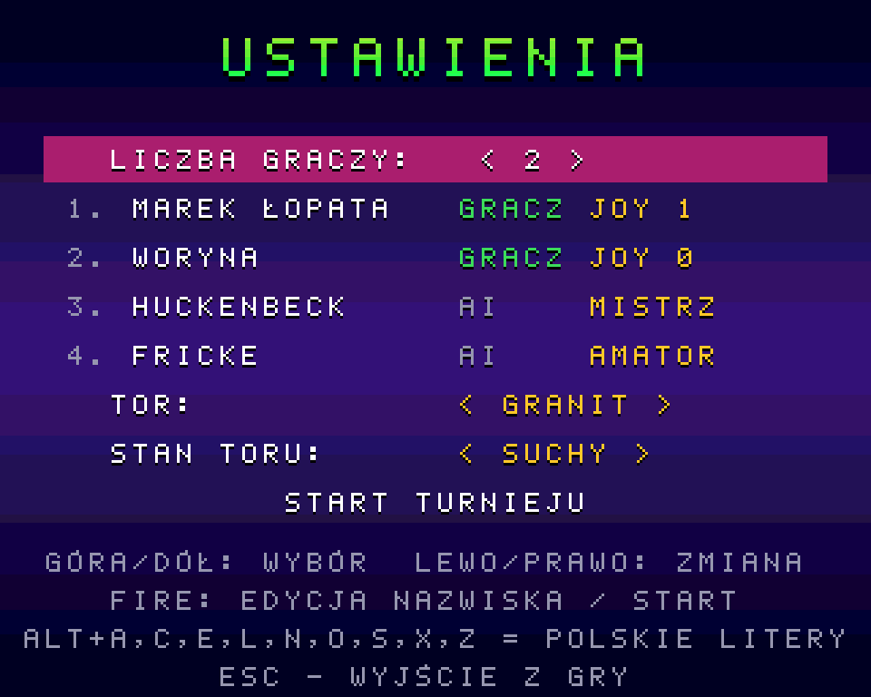

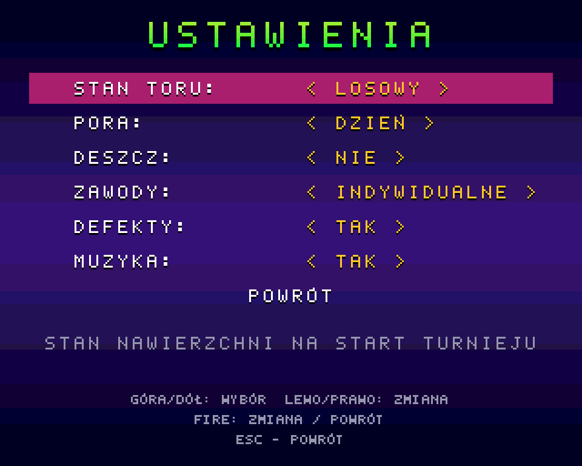

### Program zawodów i prezentacja

Przed każdym biegiem program pokazuje, kto startuje z którego pola, oraz tabelę punktów ze wszystkich biegów i rekordy toru. Potem podprowadzające stają na polach A–D z tablicami w kolorach kasków zawodników, którzy z nich startują, z logo sponsorów z banerów na murawie (3 sekundy albo FIRE). Kołyszą się w rytm, a któraś co chwilę posyła buziaka.

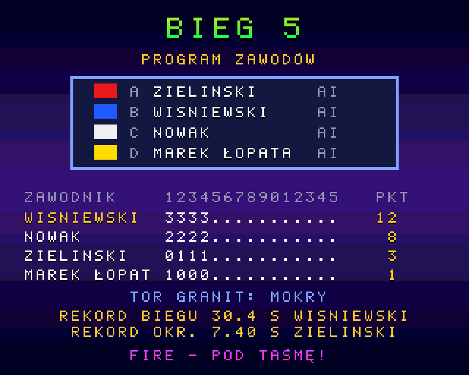

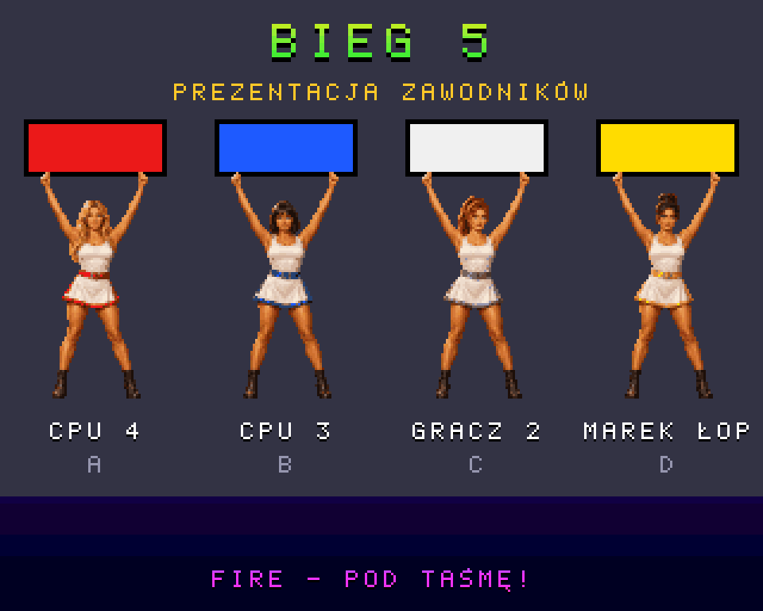

### Bieg

Na dole ekranu jest pasek: kolory kasków w kolejności na torze, numer okrążenia, okrągłe światła startowe (gasną 2 s po starcie – w biegu nie są potrzebne) i sędzia z flagą. Przy starcie na środku ekranu, na murawie (nad zawodnikami na prostej), widać okienko maszyny startowej z lampką i taśmą.

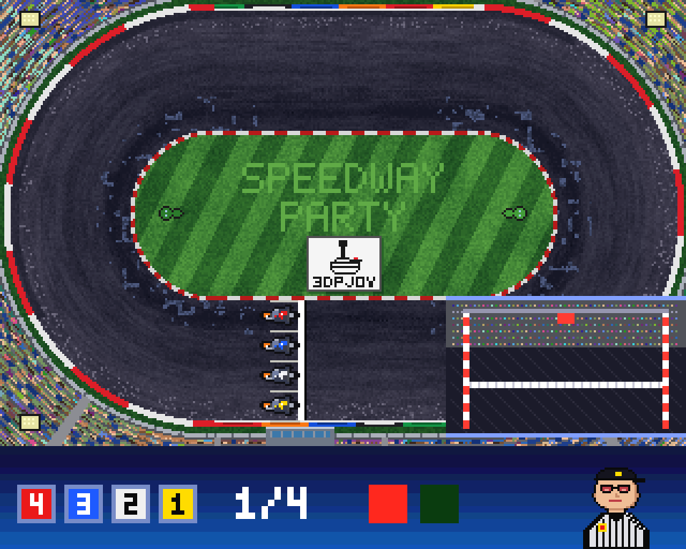

### Wyniki, przerwa na tor, podium i gazeta

Po biegu – wyniki z punktami i czasem. Po biegach 4, 7, 11 i 13 traktory równają i polewają tor. Po ostatnim biegu – podium, a po nim gazeta „GŁOS OWALU” z podsumowaniem zawodów. FIRE na gazecie zaczyna nowy turniej.

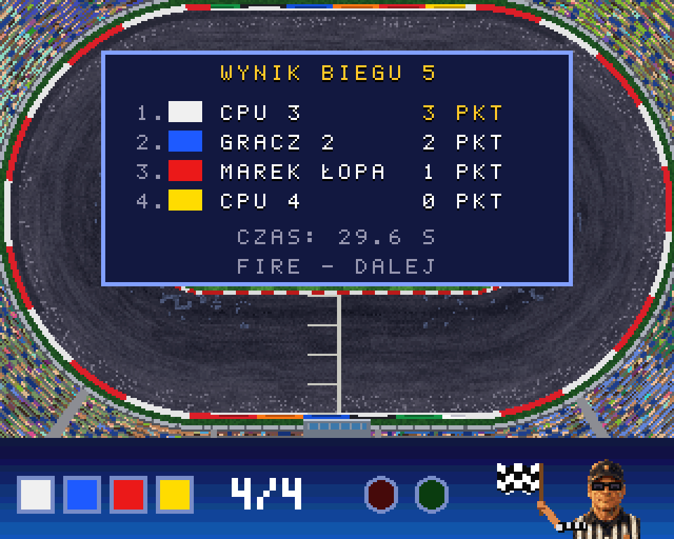

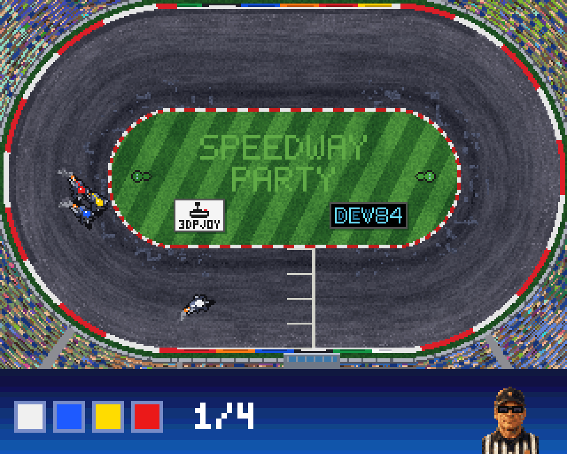

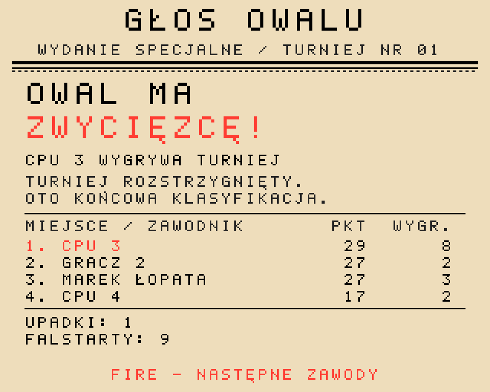

### Rekordy toru

Tor ma dwie tabele: **5 najlepszych biegów** (czas całych 4 okrążeń) i **5 najlepszych okrążeń**. Po każdym biegu wpada do nich każdy gracz, który dojechał do mety i ma wystarczająco dobry czas. Boty nie wchodzą do tabel, więc pokaz z samymi botami (0 graczy) niczego nie zapisuje. Przy równym czasie wyżej zostaje ten, kto wpisał się wcześniej.

Gracz, który w turnieju wjechał do piątki, po zawodach (po gazecie) wpisuje – raz, do wszystkich swoich miejsc; między biegami gra nie przerywa – **imię – do 7 znaków** (domyślnie pierwsze słowo nazwiska): GÓRA/DÓŁ zmienia znak (spacja, A–Z, polskie litery, 0–9, `-`), LEWO/PRAWO pozycję, można też pisać z klawiatury (Alt + litera = polska litera, Backspace cofa). FIRE albo Return zapisuje, ESC zostawia to, co jest na ekranie. Gdy do piątki wjechało kilku graczy, wpisują po kolei. Jeśli turniej zostanie przerwany (ESC), miejsca jego graczy dostają imiona z nazwisk.

Tabele zapisują się w pliku `halloffame.dat` obok gry (poprzednia wersja zostaje jako `halloffame.bak`) przy wyjściu z gry: ESC na ekranie wyboru i ESC jeszcze raz. Reset albo wyłączenie Amigi w trakcie gry traci wyniki z tej sesji, a na zabezpieczonej dyskietce zapis się po cichu nie udaje. Rekordy graczy ze starego pliku `records.dat` są przenoszone raz, przy pierwszym starcie.

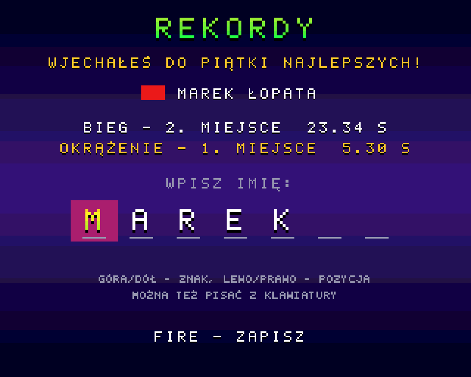

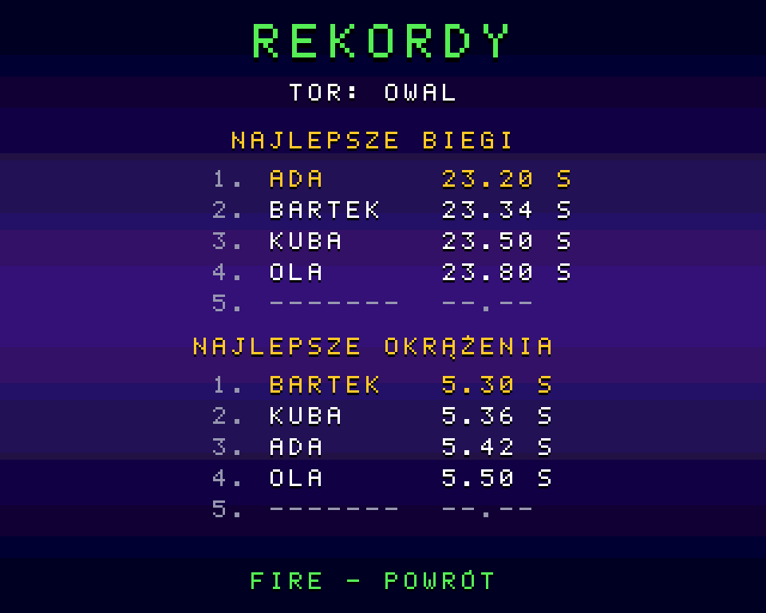

## 4. Zasady turnieju

- **15 biegów, po 4 okrążenia, po 4 zawodników.** Punkty za miejsca: 3, 2, 1, 0.
- **Każdy startuje z każdego pola** – program biegów 1–13 jest tak ułożony.
- **Biegi nominowane (14 i 15):** lider tabeli wybiera pole pierwszy, potem kolejni.
- **Bieg dodatkowy:** remis punktowy o miejsce na podium rozstrzyga dodatkowy bieg zawodników z remisu, z losowanymi polami. Remis poza podium rozstrzygają zwycięstwa biegów.
- **Defekty** (w ustawieniach turnieju, domyślnie włączone): przed każdym biegiem punktowanym każdy zawodnik ma 2% szansy na awarię motocykla, najwyżej jedną w turnieju – średnio wypada około jednego defektu na turniej. W losowej chwili biegu silnik zaczyna się krztusić i dymić, po 1,5 s gaśnie, a zawodnik zjeżdża na murawę i stoi tam do końca biegu. Zawodnik dostaje 0 punktów, a w tabeli „D”. Kto zdąży dojechać do mety, zanim silnik zgaśnie, kończy bieg normalnie. W biegu dodatkowym defektów nie ma.
- **Kolor kasku** jest stały dla zawodnika przez cały turniej (czerwony, niebieski, biały, żółty). Pole startowe zmienia się co bieg.
- **Boty:** Nowicjusz (spóźnia się pod taśmą, łamie za mocno, trzyma się krawężnika), Profesjonalista (refleks, „zamyka płot” przy próbie wyprzedzania od wewnątrz), Mistrz (czyta przyczepność toru, dawkuje uślizg, potrafi odjechać szeroko).

### Flagi sędziego

| Flaga | Znaczenie |
|---|---|
| szachownica | koniec biegu: od wjazdu prowadzącego na ostatnią prostą do mety ostatniego zawodnika |
| czerwona | przerwanie biegu, np. po dotknięciu taśmy |
| czarna | wykluczenie zawodnika (np. druga taśma w biegu) |
| żółta z czarnym krzyżem („kosa”) | ostatnie okrążenie |
| narodowa | awaryjny start po awarii maszyny startowej |

Gdy nic się nie dzieje, sędzia mruga i zerka na boki zza przyciemnianych okularów.

## 5. Start spod taśmy

1. Trzymaj LEWO albo PRAWO, gdy zawodnicy stoją pod taśmą.
2. Pali się czerwone – czekasz sekundę, dwie, trzy, nigdy nie wiadomo ile.
3. Zielone, brzęczyk, trzask zwolnionej taśmy – **puść od razu**. Im szybciej puścisz, tym lepszy start.

- **Za wcześnie:** gwizdek, „TAŚMA!”, czerwona flaga i ostrzeżenie. Druga taśma w tym samym biegu to wykluczenie.
- **Za późno** (dłużej niż 0,3 s po zielonym): koło mieli w miejscu.
- **Awaria maszyny:** czasem światła gasną, a sędzia startuje bieg flagą narodową – trzeba patrzeć na jego rękę.

## 6. Jazda i linia jazdy

**LEWO** kładzie motocykl w uślizg (rama w łuk, najwyżej 40°). **PRAWO** to kontra – prostuje motocykl (do ok. 14°).

- **Każdy stopień uślizgu kosztuje prędkość.** Motocykl złamany do oporu skręca ostro, ale zwalnia o jedną czwartą. Najszybciej jedzie się pulsując: złamać na wejściu w łuk, odpuścić w środku, wyprostować na wyjściu.
- **Banda** zabiera ćwierć prędkości, **krawężnik** lekko spowalnia, **kontakt łokieć w łokieć** spowalnia obu zawodników.
- **Szpryca:** motocykl w uślizgu sypie spod tylnego koła nawierzchnię. Jazda tuż za rywalem w jego szprycy spowalnia – trzeba szukać czystej linii.

### Najlepsza linia jest inna na każdych zawodach

Na start każdego turnieju tor dostaje 1–2 wyjeżdżone, ubite ścieżki w losowym miejscu przekroju. Ścieżkę widać jako ciemniejszy pas. Na niej:

- przyczepność jest lepsza (szybsze rozpędzanie, ostrzejszy skręt),
- **uślizg kosztuje mniej prędkości** – do 40% mniej na środku ścieżki; im dalej od niej, tym kara stopniowo rośnie.

Tor wyjeżdża się też z biegu na bieg: linia, którą jeździ cała stawka, ciemnieje i trzyma coraz lepiej, a grudki szprycy obok ją spulchniają. Równarka w przerwie zaciera ścieżki.

### Odsypisko i „szeroka niesie”

Pod bandą zbiera się luźna nawierzchnia. Wjazd tam za wolno – motocykl się zakopuje. Wjazd z pełną prędkością w lekkim uślizgu – „szeroka niesie” i odsypisko przyspiesza. Wyjeżdżona, ubita ścieżka pod bandą już nie zakopuje. Wyjątek: od taśmy do pierwszego łuku wszyscy mają tę samą przyczepność (ze środka toru) i nikt się nie zakopuje – pole D pod bandą rusza tak samo szybko jak pole A.

### Polewanie i schnięcie

Stan toru na start jest domyślnie losowany (można go ustawić w ustawieniach turnieju). Mokry tor trzyma wyraźnie gorzej – trzeba łamać mocniej. Po biegach 4, 7, 11 i 13 tor jest równany i polewany, a potem z biegu na bieg przesycha.

### Zawody w nocy

W ustawieniach turnieju PORA: NOC. Tor oświetlają cztery maszty z reflektorami w rogach trybun: łuki są w ciepłym świetle, proste w półmroku. Noc nie zmienia jazdy – przyczepność, ścieżki, polewanie i defekty działają tak samo; ciemniej jest tylko na ekranie (szpryca i woda też są ciemniejsze w cieniu).

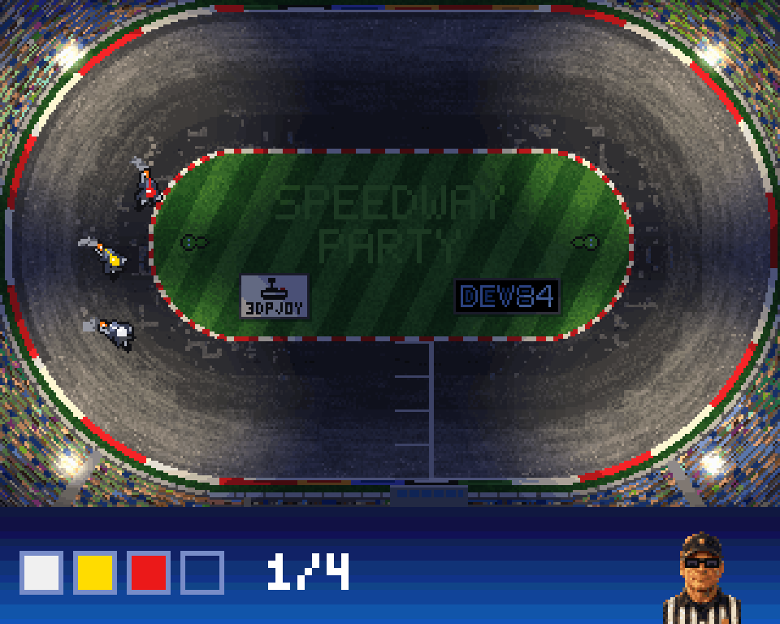

# Część II. Dla twórców

## 7. Budowanie

### Toolchain

Najprościej na Windows przez **WSL2 z Ubuntu**. Toolchain Bebbo buduje się raz (ok. 30–60 min):

```bash
sudo apt update
sudo apt install make wget git gcc g++ lhasa libgmp-dev libmpfr-dev libmpc-dev flex bison gettext texinfo ncurses-dev autoconf rsync libreadline-dev
git clone https://github.com/bebbo/amiga-gcc
cd amiga-gcc
make update
make all -j4 PREFIX=$HOME/amiga-gcc
echo 'export PATH=$HOME/amiga-gcc/bin:$PATH' >> ~/.bashrc
```

NDK 3.9 i libnix są w toolchainie. Sprawdzenie: `m68k-amigaos-gcc --version`.

### Gra, paczka i dyskietka

| Polecenie (w WSL, w katalogu projektu) | Wynik |
|---|---|
| `make dist` | katalog `dist/`: program, `data/`, `s/startup-sequence` – do podpięcia w emulatorze. Motocykle, traktory, tło toru i podprowadzające są tam spakowane (`tools/pack.py`, prosty LZ: 171 → 72 KB); gra rozpakowuje je przy wczytywaniu. W `data/` w repozytorium leżą niespakowane. |
| `make dist-en` | katalog `dist-en/` z wersją angielską (`-DLANG_EN`; napisy w kodzie jako `T("po polsku", "in English")` – nowy napis zawsze w obu językach, angielski musi się zmieścić tam gdzie polski) |
| `make release` | `release/SpeedwayParty.zip` (obie wersje) i startowe dyskietki `release/SpeedwayParty_PL.adf`, `release/SpeedwayParty_EN.adf` |
| `python tools/mkicons.py preview` | ikony Workbencha (gra, szuflada, dysk, instrukcja) – podgląd PNG |
| `make whdload` | wersja WHDLoad w przygotowaniu (`dist-whd/`), jeszcze nieprzetestowana i niewydana |
| `make check` | kontrola składni i typów całego kodu Clangiem dla 68020 |
| `make sim` | symulator turnieju botów z tą samą logiką gry |
| `make asan` | kontrola pamięci (AddressSanitizer, gcc w WSL): zrzuty PL i EN, trailer i symulator – wyłapuje m.in. za krótkie bufory napisów, które na Amidze po cichu psują stos |

Flagi kompilatora: `-m68020 -mtune=68020 -O2 -fbbb=- -fomit-frame-pointer -noixemul`. Opcja `-fbbb=-` wyłącza dodatkowy optymalizator Bebbo, który w skokach przez tablice `switch` gubił potrzebne przepisanie rejestru.

Gotowe dane (`data/`) są w repozytorium – do samego budowania gry Python nie jest potrzebny.

### Muzyka w menu (build.cfg)

```
MUSIC = BlackMotor
```

| Wartość | Utwór |
|---|---|
| `BlackMotor` | „Black Motor”, 13,3 s, 208 KiB (domyślnie) |
| `NightGrid` | „Night Grid”, 27,4 s, 428 KiB |
| `BRAK` | bez muzyki, oszczędza Chip RAM |

Utwory leżą w `src/music/<nazwa>/` jako miksy `*_s8.raw` (PCM 8 bit mono, ~16 kHz). Jednorazowo: `make dist MUSIC=NightGrid`.

## 8. Architektura gry

### Pętla główna (50 Hz)

Gra przejmuje system (`system.c`) i działa na własnym przerwaniu VBL. Każda klatka:

1. czeka na pionowy wygaszacz (`system_wait_vbl`),
2. czyta wejście i liczy logikę (`update_state`: start, jazda, boty, szpryca, turniej),
3. rysuje do bufora „back” (`ui_render`, szpryca),
4. ustawia duszki, aktualizuje HUD i dźwięk,
5. czeka na Blitter i przełącza bufory (`video_swap`).

Cała praca musi zmieścić się w jednej klatce: 313 linii obrazu PAL. Wersja `make dist EXTRA=-DSHOW_LAG` pokazuje w HUD zgubione klatki i czasy poszczególnych części w liniach obrazu.

### Obraz

- **Pole gry:** 320×208, 8 bitplanów (256 kolorów, paleta 24-bit AGA), bitplany przeplatane, podwójny bufor. Pod spodem jest tło toru (`g_video.background`), z którego odtwarzane są fragmenty.
- **HUD:** 320×48, 5 bitplanów (32 kolory), pojedynczy bufor. Sędzia, ręka z flagą (dwie fazy machania zapamiętane w buforze), kolory kasków, okrągłe światła.
- **Copper:** kolory per linia (gradient tła menu, tęczowy tekst, kremowy papier gazety), osobne listy dla biegu i menu.
- **Duszki:** motocykle to pary attached 32 px (15 kolorów); każdy motocykl ma własną kopię klatki na każdy bufor, a pozycja w poziomie jest ustawiana co 1/4 piksela. Klatki: 4 kolory kasków × 32 kierunki × 3 stopnie uślizgu.
- **Blitter:** wypełnianie, kopiowanie, kropki szprycy („cookie-cut”). Procesor przed rysowaniem w buforze czeka na koniec blitu (`hw_wait_blit`/`blit_wait`).

### Wydajność na A1200 bez Fast RAM

Na gołym A1200 program i dane siedzą w Chip RAM, który współdzieli z układem obrazu. Zasady, które pozwalają utrzymać 50 klatek:

- ekrany menu przerysowywane są tylko przy zmianie; migający napis odświeża sam pasek,
- wyjeżdżone ścieżki na torze przemalowują się między biegami (po kilka wierszy na klatkę), w biegu zmienia się tylko przyczepność,
- mieszanie palety toru (schnięcie, polewanie) idzie po 64 kolory na klatkę,
- okienko maszyny startowej i fazy flagi rysowane są raz i kopiowane z pamięci,
- kosztowne rysowanie bajtami zamiast piksel po pikselu w 8 planach.

### Dźwięk (Paula)

Cztery kanały: dwa silniki (dwaj najwyżej sklasyfikowani spośród jadących; w menu – muzyka w podwójnym buforze), kibice, efekty (brzęczyk z trzaskiem taśmy, gwizdek, okrzyk trybun, gdy prowadzący wjeżdża na ostatnią prostą – ok. 0,6 s przed metą). Silnik to pętla 8 cykli zapłonu z nagrania (`data/engine.raw`); wysokość tonu zmienia się z obrotami przez okres odtwarzania Pauli. Okrzyk trybun (`data/cheer.raw`, 2,6 s) generuje `tools/genaudio.py`; jeśli w `src/` leży nagranie `crowd_cheer.wav`, okrzyk powstaje z niego (mono, 11 025 Hz, najwyżej 3 s).

### Moduły

| Plik | Odpowiada za |
|---|---|
| `main.c` | pętla 50 Hz, maszyna stanów turnieju |
| `system.c` | przejęcie i oddanie sprzętu, przerwanie VBL |
| `video.c` | listy Coppera, palety, podwójny bufor, HUD |
| `sprites.c` | klatki (jeden komplet, kolor kasku przy kopiowaniu) i pozycje duszków motocykli |
| `blit.c` | operacje Blittera |
| `start.c` | procedura startowa, taśma, refleks |
| `race.c` | model jazdy: gaz, uślizg, banda, kontakt, okrążenia |
| `ai.c` | boty |
| `roost.c` | szpryca i woda z polewaczki |
| `track.c` | geometria owalu, przyczepność, wilgotność, wyjeżdżone ścieżki |
| `tractors.c` | przerwa na tor |
| `tournament.c` | program 15 biegów, punkty, biegi nominowane i dodatkowe, fakty do gazety |
| `newspaper.c` | gazeta po zawodach: podsumowanie i wybór nagłówka |
| `ui.c`, `text.c` | ekrany, font z polskimi literami |
| `hud.c` | pasek na dole ekranu, sędzia |
| `audio.c` | Paula: silniki, kibice, efekty, muzyka |
| `input.c` | joysticki, klawiatura, adapter LPT |
| `assets.c`, `records.c`, `hof.c` | wczytywanie danych (i rozpakowywanie plików z `tools/pack.py`); rekordy toru TOP 5 (`halloffame.dat`: zapis, kopia, import starego `records.dat`; logika tabel w `hof.c`) |

### Dane (katalog data/)

Wszystkie pliki generują narzędzia z `tools/` i są w repozytorium: tor (`track0.bpl`, `track0.pal`), plansza tytułowa (`title.bpl`, `title.pal`), motocykle (`bikes.spr`: jeden komplet klatek, kolor kasku nadaje gra), traktory (`tractors.spr`), HUD (`hud.pal`, `referee.bin`, `refarm.bin`), podprowadzające (`girls.bin`), dźwięki (`engine.raw`, `crowd.raw`, `buzzer.raw`, `whistle.raw`, `cheer.raw`) i muzyka (`music.raw`, kopiowana przy budowaniu).

## 9. Uruchomienie w WinUAE

Gotowa konfiguracja: `tools/winuae/SpeedwayParty-A1200.uae` (wpisz w niej ścieżkę do swojego `dist/`).

1. Model A1200, Kickstart 3.0/3.1 (własny ROM, np. z Amiga Forever) albo AROS.
2. CPU 68020 *cycle-exact*, bez FPU.
3. RAM: Chip 2 MB, Slow 0, Fast 0.
4. Chipset AGA, PAL.
5. *CD & Hard drives → Add Directory*: katalog `dist/`, *Device name* `DH0`, *Boot priority* 0 lub wyżej.
6. *Game ports:* port 1 = joystick (np. strzałki), port 0 = drugi joystick (np. pad albo joystick USB) w trybie **Joystick**, nie myszy. Nie zostawiaj myszy w porcie 0.

### Gdy coś nie działa

| Objaw | Przyczyna / rozwiązanie |
|---|---|
| Zamiast grafiki proste kształty | brak katalogu `data/` obok programu |
| Brak dźwięku | brak `data/*.raw` |
| Brak muzyki w menu | `MUSIC = BRAK`, brak `data/music.raw` albo MUZYKA: NIE w ustawieniach |
| Joystick w porcie 0 (JOY 0) łapie tylko lewo, nie łapie prawa, „rusza” przy puszczeniu do środka | emulator podaje joystick w porcie 0 jako mysz: ustaw dla portu 0 tryb **Joystick** (WinUAE: `joyport0mode=djoy`, jak w szablonie; w innym emulatorze analogicznie) |
| Menu samo się przełącza | mysz w porcie 0 |
| Strzałki nie działają, bieg czeka na start | w szablonie WinUAE strzałki emulują joystick w porcie 1 – wybierz JOY 1 albo STRZAŁKI (czytają oba źródła) |
| Obraz poszatkowany | `DDF_STOP` i `MOD_ADJ` w `src/video.c` |

## 10. Narzędzia na PC i testy

Wymagają Pythona 3 z `numpy`, ffmpeg w PATH, a kontrola kodu i symulator – `pip install ziglang`.

| Polecenie | Co robi |
|---|---|
| `make assets` | regeneruje grafikę, dźwięk i font (`genart`, `gentitle`, `gengirls`, `genaudio`, `genfont`) |
| `python tools/gentitle.py` | plansza tytułowa z ilustracji `src/title.png` |
| `python tools/gennight.py` | zawody w nocy: paleta nocna i mapa światła reflektorów (`data/track0n.pal`, `data/track0n.map`); gra przelicza dzienny tor na nocny przy starcie turnieju |
| `python tools/genreferee.py` | portret sędziego i malowana ręka z ilustracji `src/referee.png` |
| `python tools/gengirls.py` | podprowadzające z ilustracji `src/girls.png` |
| `python tools/import_engine.py plik.wav` | pętla silnika z nagrania (obecnie `src/speedway_500cc_10000rpm_loop.wav`) |
| `sh tools/shots/run.sh` | zrzuty ekranu z prawdziwego kodu gry skompilowanego na PC (`art/screen_*.png`; z `LANG_EN=1` angielskie w `art/en/`) |
| `sh tools/mktrailer.sh` | trailer `art/trailer.mp4` |
| `sh tools/sim/news_test.sh` | testy gazety (reguły nagłówków, podsumowanie, długie nazwiska) |
| `sh tools/sim/records_test.sh` | testy tabel rekordów i pliku `halloffame.dat` |
| `sh tools/sim/sprites_test.sh` | test klatek motocykli (kolor kasku nadany przy kopiowaniu = dawne 4 komplety) |
| `sh tools/sim/start_test.sh [turnieje]` | uczciwość startu: 4 jednakowe boty, wyniki wg pola A–D (prędkość po 1 s, miejsce w 1. łuku i na mecie, zwycięstwa); `DIAG=1` – szpryca, krawężnik, linia jazdy |
| `sh tools/sim/pack_test.sh` | test rozpakowywania danych spakowanych na dyskietce |
| `sh tools/sim/batch.sh` | kilka turniejów botów – statystyki poziomów AI |
| `python tools/mksocial.py` | miniaturka repozytorium na GitHubie |
| `python tools/mkdocs.py` | ta dokumentacja w PDF (polska i angielska) |
| `make dist EXTRA=-DAUTOPLAY` | wersja testowa: sama przechodzi menu i rozgrywa turniej botów |
| `make dist EXTRA=-DSHOW_LAG` | pomiar: zgubione klatki i czasy w HUD |
| `make dist EXTRA="-DSHOW_LAG -DSHOW_START"` | pomiar samego startu spod taśmy |

Geometria toru jest w dwóch miejscach: `track_defs` w `src/track.c` i `PRESETS` w `tools/genart.py` – wartości muszą być identyczne.

## 11. Stack technologiczny

| Obszar | Czego używamy |
|---|---|
| Platforma | Amiga 1200: 68020, AGA, 2 MB Chip RAM, bez Fast RAM, PAL 50 Hz |
| Język | C (gnu99), bez bibliotek gry – bezpośrednie programowanie Coppera, Blittera, duszków, Pauli i CIA |
| Kompilator | Bebbo amiga-gcc 6.5.0b, NDK 3.9, libnix, make w WSL2 (Ubuntu) |
| Emulator | WinUAE (A1200, 68020 cycle-exact, AGA, ROM AROS) |
| Narzędzia | Python 3 + numpy (grafika, palety, dźwięk, ADF, paczka, dokumentacja), ffmpeg |
| Testy | Clang z pakietu `ziglang`: kontrola kodu, symulator, zrzuty i trailer, testy gazety |
| Grafika | pikselart generowany kodem; ilustracje przygotowane generatorem obrazów AI i przekonwertowane do palet gry |
| Repozytorium | git, GitHub |
| Asystenci AI | Claude (Anthropic), GPT-6 Astra |

## 12. Stan i znane ograniczenia

- Gra działa w WinUAE w 50 FPS; w całym biegu gubią się pojedyncze klatki (kilka przy odlocie taśmy i zmianie flagi).
- **Nie była jeszcze testowana na prawdziwym A1200** ani z oryginalnym Kickstartem 3.1.
- Zajmuje ok. 1,05–1,25 MB Chip RAM, więc potrzebuje 2 MB Chip.
- Słychać tylko dwa silniki naraz (Paula ma 4 kanały): dwóch najwyżej sklasyfikowanych, którzy jeszcze jadą.
- Dźwięk silnika pochodzi z nagrania wygenerowanego przez AI (500 cm³, 10 000 obr/min), zapętlonego narzędziem `tools/import_engine.py`.
- Adapter 4 graczy na porcie równoległym nie był testowany.
- Tylko PAL.

**Do zrobienia:** tryb treningu, więcej torów, test na prawdziwym A1200.

## 13. Jak aktualizować tę dokumentację

1. Edytuj `docs/DOKUMENTACJA.md` i angielską `docs/DOCUMENTATION.md` (zwykły Markdown: nagłówki `#`, listy `-`, tabele `| |`, obrazki ``, kod w blokach z trzema odwrotnymi apostrofami).
2. Jeśli zmieniły się ekrany, odśwież zrzuty: `sh tools/shots/run.sh` i `LANG_EN=1 sh tools/shots/run.sh`.
3. Zrób PDF: `python tools/mkdocs.py` → `docs/SpeedwayParty-dokumentacja.pdf` i `docs/SpeedwayParty-documentation.pdf` (`--pl` albo `--en` – tylko jedna). Wersja (commit z gita) i data wstawiają się same.

Nagłówek `#` zaczyna nową część na nowej stronie, `##` to rozdział w spisie treści.

## 14. Twórcy i licencja

Gra: **b4rtiga**, przy pomocy sztucznej inteligencji: **Claude** (Anthropic) oraz **GPT-6 Astra**.

Licencja **MIT** © 2026 b4rtiga. Kod źródłowy: github.com/b4rtiga/Speedway-Party
